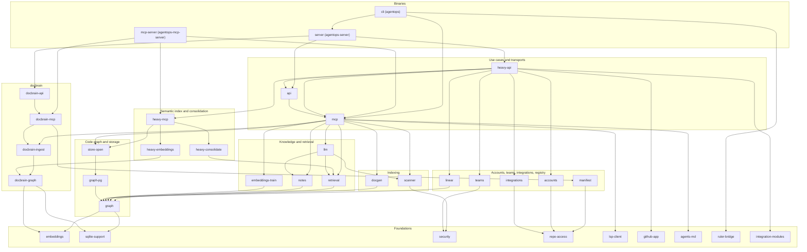
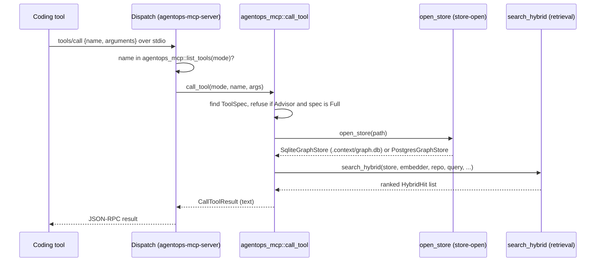
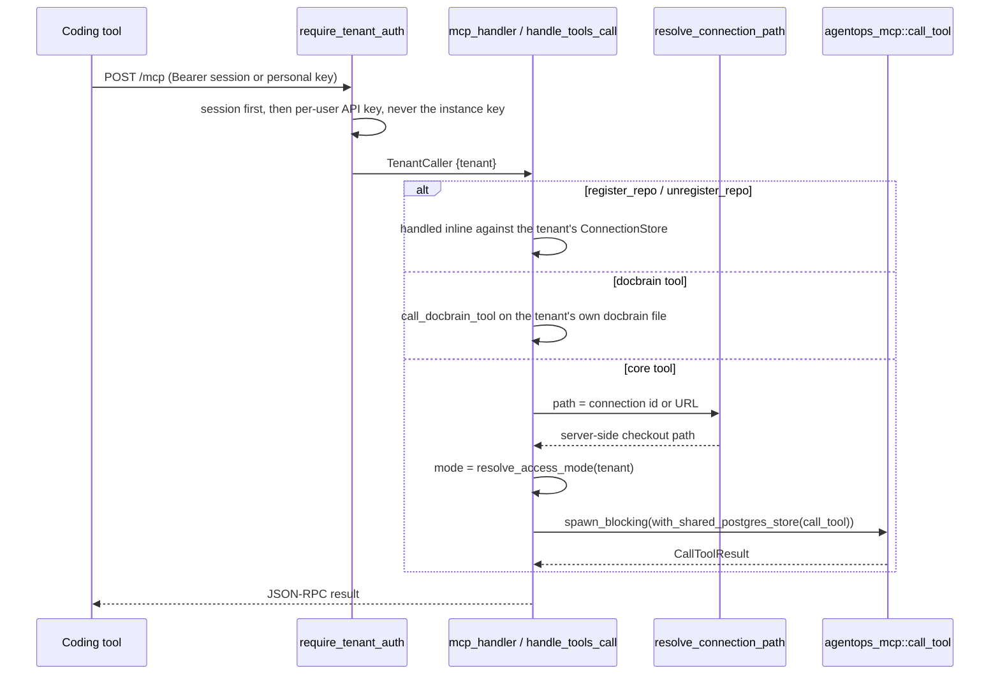

# Architecture

How AgentOps is put together: its layers, its three binaries, and how a request flows through each transport. Read this before changing code that crosses a crate boundary; every other engineering doc assumes it.

## System overview

AgentOps scans a repository into a graph of files, symbols and dependencies. Developers and agents attach tribal knowledge to that graph as gotchas, decisions and notes. Hybrid search (dense, lexical, exact name, plus graph expansion) retrieves both code and knowledge. `docbrain` gives third-party library documentation the same ingest-and-search treatment.

Everything is exposed three ways:

- **MCP** for coding agents: a local stdio server, or the hosted `/mcp` endpoint.
- **REST** for the web app and scripts.
- **A web app** (`apps/web`) for humans.

All Rust code lives in one Cargo workspace of 36 crates (`Cargo.toml`). Per-crate detail is in [02-crate-reference.md](02-crate-reference.md); storage is in [03-data-model.md](03-data-model.md).

## Architectural style

The crates follow a ports-and-adapters split. Use cases depend on traits; adapters implement them.

| Port (trait) | Defined in | Adapters |
| --- | --- | --- |
| `GraphStore` | `agentops-core/crates/agentops-graph/src/lib.rs` | `SqliteGraphStore` (`agentops-graph/src/sqlite.rs`), `PostgresGraphStore` (`agentops-graph-pg`) |
| `DocbrainStore` | `docbrain-core/crates/docbrain-graph/src/lib.rs` | `SqliteDocbrainStore` |
| `Embedder` | `agentops-core/crates/agentops-embeddings/src/lib.rs` | `LocalEmbedder` (fastembed) |
| `SymbolMatcher`, `NoteClassifier` | `agentops-core/crates/agentops-notes/src/lib.rs` | `WordBoundaryMatcher`, `HeuristicClassifier` (notes); `LlmAssistedMatcher`, `LlmAssistedClassifier` (`agentops-llm`) |
| `CandidateSource`, `EmbeddingProjector` | `agentops-core/crates/agentops-retrieval/src/lib.rs` | dense, lexical and exact sources; the projection head in `agentops-embeddings-train` |
| `SecretsProvider` | `agentops-core/crates/agentops-repo-access/src/secrets.rs` | `EnvSecretsProvider` |
| `LibraryDiscovery`, `ChangelogSync` | `docbrain-core/crates/docbrain-ingest/src/lib.rs` | `RegistryDiscovery`, `GitHubReleasesSync` |

The `agentops-embeddings` module doc states the rule: "Use cases depend on `&dyn Embedder`, never on `fastembed` or `LocalEmbedder` directly."

Driving adapters (MCP servers, REST routers, the CLI) stay thin. They parse input and call one shared use-case layer. `agentops-mcp` owns that layer for code-graph tools, and `agentops-api` wraps the same `agentops_mcp::call_tool` for REST.

## Component diagram

Arrows point from a crate to what it depends on. Crate names drop the `agentops-` prefix. Minor edges are omitted; the full list is in [02-crate-reference.md](02-crate-reference.md).

## Layers

Layer names approved by the author (`questions.md` A-4). Layers group crates by job. They are not strict dependency levels; measured depths are in `survey/layers.md`.

| Layer | Crates | Job |
| --- | --- | --- |
| Foundations | `security`, `sqlite-support`, `embeddings`, `repo-access`, `agents-md`, `ruler-bridge`, `lsp-client`, `github-app`, `integration-modules` | Leaf crates with no internal dependencies: redaction, SQLite helpers, local embeddings, repo credentials, generators, external clients. |
| Code graph and storage | `graph`, `graph-pg`, `store-open` | Graph entities, the `GraphStore` port, its SQLite and Postgres adapters, and backend selection. |
| Indexing | `scanner`, `docgen` | Turning source files into symbols and edges; rendering docs from the graph. |
| Repo registry | `manifest` | Which repos this machine has scanned (`~/.agentops/manifest.json`). |
| Knowledge and retrieval | `retrieval`, `notes`, `llm`, `embeddings-train` | Hybrid search, note ingestion and matching, LLM features, embedding consolidation. |
| Integrations | `linear`, `integrations` | Linear task sync; the encrypted per-tenant credentials vault. |
| docbrain | `docbrain-graph`, `docbrain-ingest`, `docbrain-mcp`, `docbrain-api` | Library documentation: store, ingestion, MCP and REST adapters. |
| Semantic index and consolidation | `heavy-embeddings`, `heavy-consolidate`, `heavy-mcp` | BGE-M3 + Qdrant semantic index with reranking; local LoRA consolidation. |
| Accounts and teams | `accounts`, `teams` | Users, sessions, 2FA, device login; organizations, roles, invites, audit log. |
| Use cases and transports | `mcp`, `api`, `heavy-api` | Tool table and use cases; single-operator REST; multi-tenant REST and `/mcp`. |
| Binaries | `server`, `mcp-server`, `cli` | Process entry points. |

### The "heavy" prefix

Crates named `agentops-heavy-*` are not a separate tier. "Heavy" was the paid suite of an abandoned SaaS plan, next to a free "light" suite. The author chose open source instead (`questions.md` A-2). The split was removed in `218c3fc` (2026-08-24); the names remain. `agentops-mcp-server`, the local stdio binary, links two heavy crates, and `agentops-server` links all four.

## Binaries

### agentops-server

The merged REST server. `agentops_server::run` (`agentops-core/crates/agentops-server/src/lib.rs`) builds four routers and serves them on one port:

| Router | Built by | Mounted at |
| --- | --- | --- |
| Single-operator REST | `agentops_api::build_router_without_dashboard_routes` | `/` |
| docbrain REST | `docbrain_api::build_router_without_health` | `/docbrain` |
| Multi-tenant REST and `/mcp` | `agentops_heavy_api::build_full_router(&heavy_db_path, false)` | `/` |
| One-line installer | `connect_sh::router` | `/` |

Route collisions decide this shape. `axum::Router::merge` panics on a duplicate path (gotcha 54070, "axum's Router::merge panics on any duplicate (path, method)"). The `agentops-server` module doc records how each collision was resolved:

- `/health` is served once, by `agentops-heavy-api`.
- `/tools` and `/tools/{name}` stay `agentops-api`'s. docbrain's are nested under `/docbrain`. `agentops-heavy-api`'s are excluded (`include_tools: false`).
- `/activity`, `/local-search`, `/gotchas` and `/repos/{id}/...` dashboard routes come from `agentops-heavy-api` (tenant-scoped), not `agentops-api` (single-operator).

On every boot, `run` also upserts an `agentops` library into the global docbrain store. Hosted orgs cannot see it; see `findings.md` F3.

Config comes from env vars only; no crate loads a `.env` file (gotcha 54032). The main ones are listed below; [11-deployment-and-operations.md](11-deployment-and-operations.md) has the full reference.

| Var | Effect |
| --- | --- |
| `AGENTOPS_ADDR` | Bind address, default `127.0.0.1:8420`. |
| `AGENTOPS_ACCESS_MODE` | `advisor` (default) or `full` for REST `/tools`. |
| `AGENTOPS_API_KEY_HASH` | Optional instance-wide API key hash. |
| `AGENTOPS_DATABASE_URL` | Selects Postgres for the code graph. |
| `AGENTOPS_DATA_DIR` | Base directory for every SQLite store. |

### agentops-mcp-server

The unified stdio MCP server (`agentops-core/crates/agentops-mcp-server/src/main.rs`, `lib.rs`). Its `Dispatch` struct merges three tool tables:

1. `agentops_mcp::list_tools(mode)`: 22 core tools, filtered by access mode.
2. `docbrain_mcp::list_tools()`: 12 docbrain tools.
3. `agentops_heavy_mcp::list_tools()`: 5 semantic-index tools, only when `AGENTOPS_QDRANT_URL` is set.

`call_tool` checks each table's own name list in that order rather than sniffing "unknown tool" errors. This is the binary `agentops connect` registers in each coding tool's MCP config.

### agentops (CLI)

`agentops-core/crates/agentops-cli/src/main.rs`, `Command` enum. Subcommands by purpose:

| Purpose | Subcommands |
| --- | --- |
| Index and inspect | `install`, `status`, `repos`, `forget`, `changelog`, `watch`, `docgen`, `migrate-graph` |
| Knowledge | `note`, `ingest-notes`, `search`, `explain`, `librarian` |
| Servers | `serve` (core tools only), `docbrain-serve`, `serve-api` (full merged server) |
| Coding-tool integration | `connect`, `hook-capture`, `compress-output`, `usage` |
| Tasks | `task` (`create`, `list`, `update-status`, `close`, `activity`, `summarize`, `sync-linear`) |
| Setup | `init`, `api-key`, `sync-docs` |

`serve-api` calls `agentops_server::run`, which is why `agentops-cli` depends on `agentops-server` (`questions.md` Q1). `serve` and `docbrain-serve` run the pre-merge split servers (`findings.md` F17).

## Request traces

### stdio MCP tool call

A coding tool calls `local_semantic_search` through `agentops-mcp-server`.

Files: `agentops-core/crates/agentops-mcp-server/src/lib.rs`, `agentops-core/crates/agentops-mcp/src/tools.rs`, `agentops-core/crates/agentops-store-open/src/lib.rs`, `agentops-core/crates/agentops-retrieval/src/lib.rs`.

### Hosted /mcp tool call

Files: `agentops-core/crates/agentops-heavy-api/src/lib.rs` (route at `/mcp`, layered with `tenant_repo::require_tenant_auth`), `agentops-core/crates/agentops-heavy-api/src/tenant_repo.rs`, `agentops-core/crates/agentops-heavy-api/src/mcp_http.rs`.

`require_tenant_auth` rejects the instance-wide `AGENTOPS_API_KEY_HASH` key on purpose: "That key carries no tenant" (its doc comment). `spawn_blocking` is required because `PostgresGraphStore` blocks on its own runtime; calling it on an async thread panics (`agentops-graph-pg` module doc).

### REST tool call

`POST /tools/{name}` reaches `call_tool_handler` in `agentops-core/crates/agentops-api/src/lib.rs`. It does the same `spawn_blocking(with_shared_postgres_store(call_tool(mode, name, args)))` as hosted `/mcp`. Two differences:

- `mode` is the process-wide `AGENTOPS_ACCESS_MODE`, not the org setting (`questions.md` Q5b).
- `path` is used as given; there is no connection-id resolution.

An unknown tool name returns HTTP 404 with `{"error": ...}`. A Full-only tool called in Advisor mode returns HTTP 200 with an error result, because `call_tool` reports it as `CallToolResult::error`, not `Err`.

### Web app request

Server-side code in `apps/web` reaches the Rust server through `AGENTOPS_HEAVY_API_URL` (default `http://127.0.0.1:8420`; `apps/web/src/lib/server/heavy-api.ts`). Detail in [10-frontends.md](10-frontends.md).

## Cross-cutting invariants

Rules that span crates. Each names where it is stated or enforced.

| Invariant | Where |
| --- | --- |
| `agentops-scanner` and `agentops-security` never gain a runtime networking dependency. Grammar download happens at build time only. | `agentops-security` and `agentops-scanner` module docs; root `Cargo.toml` comment on `tree-sitter-language-pack`; `deny.toml` |
| Every `GraphStore` method is repo-scoped. | `agentops-graph` module doc |
| `GraphStore` is synchronous. Async callers wrap calls in `tokio::task::spawn_blocking` and never call from inside a running runtime. | `agentops-graph-pg` module doc; gotchas 54028, 54054 |
| Long-lived processes share one Postgres pool (`open_shared_postgres_store`, `resolve_store`, `with_shared_postgres_store`). | `agentops-core/crates/agentops-store-open/src/lib.rs`; `agentops-graph-pg` module doc |
| One `ToolSpec` row drives listing, dispatch and access gating of each core tool. | `agentops-core/crates/agentops-mcp/src/tools.rs` module doc |
| `agentops-retrieval` never depends on `agentops-embeddings-train`; it sees training only through the `EmbeddingProjector` trait. | Decision "agentops-retrieval must never depend on agentops-embeddings-train directly -- EmbeddingProjector is a plain trait for exactly this reason" |
| Training frameworks (`candle-*`) stay out of the inference path. They live only in `agentops-embeddings-train` and `agentops-heavy-consolidate`. | `agentops-embeddings-train` module doc |
| Network-calling LLM adapters live in `agentops-llm`, so `agentops-notes` stays network-free. | `agentops-llm` module doc |
| Repo credentials: one deploy key per repo; private keys are decrypted only for the duration of one git subprocess. | `agentops-repo-access` module doc |
| HTTP responses are built from hand-written DTOs, so a new store field never leaks an encrypted key. | `agentops-heavy-api` module doc |
| SQLite migrations are append-only. | `MIGRATIONS_SLICE` comments in `agentops-core/crates/agentops-graph/src/sqlite.rs`; gotcha 54076 |
| A new `NodeKind`/`EdgeRelation` variant needs the Postgres CHECK constraints widened. | gotcha 54053; `agentops-core/crates/agentops-graph-pg/schema.sql` |
| A new per-repo Postgres table must be added to `PostgresGraphStore::wipe_repo`. | gotcha 54241 |
| Merged routers must not register the same `(path, method)` twice. | `agentops-server` module doc; gotcha 54070 |
| Config is read from the process environment only; nothing loads `.env`. | gotcha 54032 |

## Architecture map

`repo-map.md` is generated by `agentops docgen` from the scanned graph. It is gitignored (`.gitignore:48`) but linked from `README.md` (`findings.md` F2).

> Unverified: whether this doc should link `repo-map.md` depends on `questions.md` Q9.

## Open questions

- Q1: CLI embedding the full server.
- Q5b: per-org vs per-process access mode.
- Q9: `repo-map.md`.
