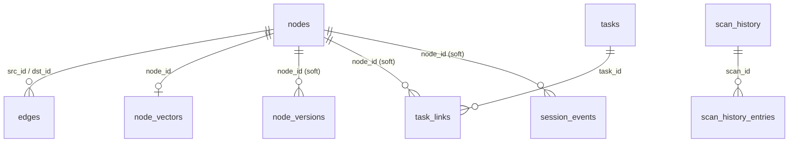

# Data model

What AgentOps stores, where it stores it, and how the schema evolves. Read this before adding a node or edge type, a column, a table or a storage backend.

## Storage map

| Store | Backend | Location | Env override | Owner crate |
| --- | --- | --- | --- | --- |
| Code graph (one repo) | SQLite | `<repo>/.context/graph.db` | `AGENTOPS_DATABASE_URL` switches to Postgres | `agentops-graph` / `agentops-graph-pg` |
| Code graph (all repos) | Postgres + pgvector | `AGENTOPS_DATABASE_URL` | — | `agentops-graph-pg` |
| Library docs (CLI, stdio, global) | SQLite | `<data>/docbrain.db` | `AGENTOPS_DOCBRAIN_DB` | `docbrain-graph` |
| Library docs (hosted, per tenant) | SQLite | `<data>/docbrain-tenants/<org>.db` | `DOCBRAIN_DB_DIR` | `docbrain-graph`, routed by `agentops-heavy-api` |
| Accounts | SQLite | `<data>/accounts.sqlite` | `AGENTOPS_ACCOUNTS_DB` | `agentops-accounts` |
| Teams | SQLite | `<data>/teams.sqlite` | `AGENTOPS_TEAMS_DB` | `agentops-teams` |
| Credentials vault | SQLite | `<data>/integrations.sqlite` | `AGENTOPS_INTEGRATIONS_DB` | `agentops-integrations` |
| Module enrollments | SQLite | `<data>/modules.sqlite` | `AGENTOPS_MODULES_DB` | `agentops-integration-modules` |
| Repo connections, indexing jobs, GitHub App installs | SQLite | `<data>/heavy-api.sqlite` | `AGENTOPS_HEAVY_API_DB` | `agentops-repo-access` |
| Server-side repo clones | Filesystem | `<data>/repo-checkouts/` | `AGENTOPS_REPO_CHECKOUTS_DIR` | `agentops-heavy-api` |
| Local scan registry | JSON file | `<data>/manifest.json` | `AGENTOPS_MANIFEST_PATH` | `agentops-manifest` |
| Embedding projection heads | safetensors files | `$AGENTOPS_DATA_DIR/models/<repo>/` | `AGENTOPS_DATA_DIR` | `agentops-embeddings-train` |
| LoRA adapters | files | `$AGENTOPS_DATA_DIR/models/<repo>/` | `AGENTOPS_DATA_DIR` | `agentops-heavy-consolidate` |
| Semantic index | Qdrant | `AGENTOPS_QDRANT_URL`, collection `agentops_semantic` | `AGENTOPS_QDRANT_COLLECTION` | `agentops-heavy-embeddings` |

`<data>` is `AGENTOPS_DATA_DIR`, default `~/.agentops` (`agentops_manifest::agentops_data_dir`; `.env.example`). Gotcha 53950 warns that two deployment methods on one host share this default.

Only the code graph has a Postgres option. Every other store is SQLite or files whatever `AGENTOPS_DATABASE_URL` says (store constructors in `agentops-heavy-api/src/lib.rs`, `build_full_router`).

SQLite needs no setup for a solo user; Postgres is used only where graph size and concurrency on the hosted server need it, and the other stores are small (ADR 0037).

## Graph model

### Node kinds

`NodeKind` (`agentops-core/crates/agentops-graph/src/lib.rs`), stored as lowercase text (`as_db_str`):

| Kind | DB value | What it is | Created by |
| --- | --- | --- | --- |
| `Symbol` | `symbol` | A function, type, method or similar, with source range | scanner via `scan_and_persist` |
| `File` | `file` | A source file | scanner |
| `Gotcha` | `gotcha` | A trap, quirk or workaround to keep seeing | `add_note`, `ingest_notes` |
| `Decision` | `decision` | A design decision and its reason | `add_note`, `ingest_notes` |
| `Note` | `note` | Other knowledge | `add_note`, `ingest_notes` |
| `Definition` | `definition` | An LLM explanation of one symbol | `explain_symbol` (`agentops-llm`) |
| `DocSection` | `doc_section` | One generated doc section, as searchable text | docgen; path `doc_section:{id}` |
| `ToolOutput` | `tool_output` | Large output of a client's own tool call | `agentops hook-capture`; path `tool_output:{session_id}:{n}` |

Every kind, `DocSection` and `ToolOutput` included, can be selected by the `kind` filter of `local_semantic_search` (`NodeKind::parse`; fixed for `findings.md` F19).

### Edge relations

`EdgeRelation`, stored as lowercase text:

| Relation | DB value | Direction | Meaning |
| --- | --- | --- | --- |
| `DependsOn` | `depends_on` | file → file | Import dependency. |
| `Documents` | `documents` | `Definition` → symbol | LLM explanation of a symbol. Its sole reader assumes a one-line `Definition` source. |
| `Affects` | `affects` | note → symbol | A gotcha or decision applies to a symbol. Reversing it silently breaks docgen badges. |
| `References` | `references` | symbol → symbol, same file | Identifier reference found syntactically; not a call graph. `agentops install --with-lsp` also adds cross-file edges from rust-analyzer (fixed for `findings.md` F25). |
| `Covers` | `covers` | `DocSection` → symbol/file | What a doc section documents; walked by `search_gist_then_detail`. |

Source: doc comments on each variant. `EdgeRelation::from_db_str` maps an unknown string to `DependsOn` and logs a warning.

### Node identity

`upsert_node` finds a node by the natural key `(repo, kind, path, name, container)` and updates it in place, keeping its id (doc comment, `agentops-graph/src/lib.rs`). `container` separates same-named symbols in one file, such as `new` in two `impl` blocks.

The key is not always unique. The scanner can emit two symbols with the same key in one file, so batch upserts dedupe internally. Gotchas:
- 54078: "The scanner can legitimately emit two Symbol entries sharing the same natural key within one file -- batch upsert must dedupe internally, not assume uniqueness".
- 54079: "Root cause of the duplicate-natural-key symbols: the scanner's (path, name, container) identity doesn't distinguish different impl blocks or nested closures sharing a name".
- 53901: "Fixed: inherent-vs-trait-impl same-method-name collision (one sub-case of the natural-key collision gotcha)".

The repo key for a local repo is the canonical directory's basename (`agentops_store_open::repo_name`). Hosted connections use `<connection_id>--<tenant>` (gotcha 54242). See `findings.md` F20 (won't fix).

### Node fields

| Field | Notes |
| --- | --- |
| `id`, `kind`, `repo` | `repo` is required on every query (`GraphStore` invariant). |
| `path`, `name`, `container`, `start_line`, `end_line` | Location. Notes use pseudo-paths (`vault:{source_path}`). |
| `content` | Symbol source, note body or section text. Notes carry their title in `name`. |
| `curated`, `prominence`, `curation_reason` | Curation. Set only by `set_curation`; never touched by `upsert_node` or rescans, so curation survives every scan. |
| `last_touched_at` | Last insert or update. Feeds recency ranking. Not populated by `PostgresGraphStore`, which returns `None`, so recency ranking is a no-op on Postgres (doc comment on the field). |

### Curation

Gotchas are permanent knowledge and are never resolved, dismissed or deleted (decision "Gotchas are curated, never resolved/dismissed -- don't reintroduce a bug-tracker model").

`NodeProminence` has four values:

| Value | Effect |
| --- | --- |
| `Full` (default) | Normal ranking. |
| `Reduced` | Ranked ×0.1 (`prominence_rank_multiplier`); requires a non-empty `curation_reason`, shown wherever the node surfaces. |
| `Pinned` | Normal ranking, plus injected into sticky session context (`nodes_pinned`, `idx_nodes_repo_prominence`). |
| `NeedsReview` | A memory nobody could classify with confidence (milestone 2, [ADR 0050](adr/0050-needs-review-curation-state.md)). Ranked ×0.1 and marked in search and `list_gotchas`; never recalled (`recallable()` is false: no prompt or subagent seed, pin, or briefing). Requires a `curation_reason`. Leaves `curated` false. |

`requires_reason()` and `recallable()` on `NodeProminence` hold those two rules in one place. `set_node_kind` changes a memory's kind in place (id, edges, embedding and curation kept); the hosted route also rewrites the note file's `type:` so the next ingest doesn't recreate the old kind.

The multiplier changes a sort key only, never a displayed score (doc comment on `prominence_rank_multiplier`).

An earlier `review_status` column modelled gotchas as bugs to close. It was added and then dropped by the next migration (`MIGRATIONS_SLICE` comments).

### Edge weights and decay

`Affects` and `References` edges are plastic. `weight` starts at 1.0 and grows when an edge is re-confirmed (`reinforce_edge`). Effective weight decays with age (`effective_edge_weight`, `age_days`), with a separate half-life per relation:

| Relation | Half-life |
| --- | --- |
| `Affects` | `AFFECTS_EDGE_HALF_LIFE_DAYS = 30.0` |
| `References` | `REFERENCES_EDGE_HALF_LIFE_DAYS = 90.0` |

A `References` edge whose target disappeared is deleted (`delete_edge`). The automatic every-scan re-match of notes must not bump `updated_at` (gotcha 53965, "Auto-rematch must not bump reinforce_edge's updated_at"). Decision "weighted decaying edges, auto note re-matching, and repo state added".

## SQLite schema

`SqliteGraphStore` (`agentops-core/crates/agentops-graph/src/sqlite.rs`). Tables, in migration order:

| Table | Purpose |
| --- | --- |
| `nodes` | All nodes. Indexes `(repo, kind)`, `(repo, path)`, `(repo, prominence)`. |
| `edges` | `src_id`, `dst_id` (FK to `nodes`), `relation`, `weight`, `updated_at`. Indexes `(repo, src_id)`, `(repo, dst_id)`. |
| `scan_history` | One row per scan with added/changed/removed counts. |
| `scan_history_entries` | Per-node changes of a scan. `node_id` is deliberately not an FK, since removed nodes are already deleted. |
| `repo_state` | One upserted row per repo: last scan, top gotcha and decision ids (JSON). |
| `node_versions` | Bi-temporal history: `valid_from`, `valid_until`. No FK, so history survives pruning. |
| `session_events` | Per-session activity and knowledge-reuse "hits" (`event_kind`, `node_id`). |
| `tasks`, `task_links` | Native tasks; partial unique index on `(external_source, external_id)` for synced issues. |
| `nodes_fts` | FTS5 external-content index over `name`, `content`, kept in sync by triggers. |
| `doc_pages` | One generated `DocPage` per repo, as opaque JSON. |
| `session_usage` | Token and cost usage per `(repo, session_id, model)`. |
| `llm_usage` | AgentOps's own LLM spend ledger, one row per call. |
| `session_report` | Per-session token breakdown, categories and resets as JSON. |
| `node_vectors` | sqlite-vec `vec0` table, `FLOAT[384]` (`EMBEDDING_DIM`). |

### Lexical index

FTS5 in external-content mode was chosen over a separate tantivy index: the database keeps it in sync through triggers, with no second write path. The backfill runs exactly once; a self-referential guard was found to corrupt the index (migration comment).

## Postgres schema

`PostgresGraphStore` (`agentops-core/crates/agentops-graph-pg`). The schema is `schema.sql`, a structural mirror of the SQLite schema. It is applied on every `connect`, and every statement is idempotent (`IF NOT EXISTS`).

Differences from SQLite:

| Aspect | SQLite | Postgres |
| --- | --- | --- |
| Scope | One file per repo | One database for all repos, separated by `repo` column |
| Embeddings | `node_vectors` (sqlite-vec) | `nodes.embedding vector(384)`, ivfflat index (`vector_cosine_ops`, `lists = 100`) |
| Lexical search | `nodes_fts` (FTS5) | `nodes.search_vector`, generated `tsvector` with GIN index |
| Kind/relation values | Free text | CHECK constraints `nodes_kind_check`, `edges_relation_check` |
| Timestamps | `TEXT` | `TIMESTAMPTZ`; shared Rust types need `::text` casts (gotchas 54055, 53953) |
| `last_touched_at` | Populated | Not populated |
| Migrations | Tracked by `user_version` | Idempotent re-apply of `schema.sql` |

Both CHECK constraints were widened for `doc_section`, `tool_output`, `references` and `covers` by dropping and re-adding them by name (`schema.sql` comments). Gotcha 54053: "Adding a NodeKind or EdgeRelation variant silently breaks PostgresGraphStore unless nodes_kind_check/edges_relation_check are also widened".

`wipe_repo` deletes one repo's rows from every per-repo table. Every new per-repo table must be added to it (gotcha 54241).

## Where embeddings live

| Embedding | Model | Stored in |
| --- | --- | --- |
| Code graph nodes (core) | fastembed `BGESmallENV15`, 384 dims (`EMBEDDING_DIM`) | `node_vectors` (SQLite) or `nodes.embedding` (Postgres) |
| Library doc nodes | same | `doc_node_vectors` in the docbrain SQLite file |
| Semantic index | BGE-M3, reranked by `bge-reranker-v2-m3` | Qdrant collection |
| Projection head | trained on top of core embeddings | `~/.agentops/models/<repo>/proj_head_v{N}.safetensors` |

Nothing is embedded by default. Embedding is opt-in through the `with_embeddings` flag of `scan_repo`, `add_note` and `ingest_notes`. Source: tool descriptions in `agentops-core/crates/agentops-mcp/src/tools.rs`. sqlite-vec KNN is capped at `k <= 4096`, and the clamp lives inside `search_similar` (gotcha 54092).

## docbrain schema

`SqliteDocbrainStore` (`docbrain-core/crates/docbrain-graph/src/sqlite.rs`), 2 tracked migrations.

| Table | Purpose |
| --- | --- |
| `libraries` | Registered libraries (slug, name, docs URL, GitHub repo). |
| `doc_snapshots` | One scraped version of a library. |
| `doc_nodes` | Chunks (`Prose` or `CodeExample`), at most `MAX_CHUNK_TOKENS = 500`. |
| `doc_edges` | `Sequence`, `ParentSection`, `CrossReference`, `HasExample`. |
| `doc_node_vectors` | Chunk embeddings. |
| `changelog_versions` | Release entries from GitHub. |
| `jobs` | Background scrape jobs (`Running`, `Succeeded`, `Failed`). |
| `repo_library_versions` | Which repo uses which library version. |

## Platform stores

All SQLite, one shared file per store with a `tenant` column, except docbrain's per-tenant files.

| File | Tables |
| --- | --- |
| `accounts.sqlite` | `users`, `sessions`, `login_challenges`, `two_factor`, `user_api_keys`, `device_auth_codes` |
| `teams.sqlite` | `organizations`, `memberships`, `custom_roles`, `invites`, `repo_access_overrides`, `audit_log` |
| `integrations.sqlite` | `credentials`, `user_credentials` |
| `modules.sqlite` | `module_enrollments` |
| `heavy-api.sqlite` | `repo_connections`, `indexing_jobs`, `indexing_job_stages`, `indexing_job_log`, `github_app_installations` |

`users` and `memberships` are in different files and are never joined in SQL (`agentops-teams` module doc).

## Migrations

### Rules

- **SQLite graph**: `rusqlite_migration` with an ordered `MIGRATIONS_SLICE`, tracked by `user_version`. A step's position is its identity, so steps are only ever appended at the end. Inserting one in the middle silently skips it on every migrated database (comment in `MIGRATIONS_SLICE`; gotcha 54076).
- **ALTER TABLE ADD COLUMN** rejects non-constant defaults such as `CURRENT_TIMESTAMP`. The pattern is a constant placeholder (`''`) followed by a backfill `UPDATE` (migration comments; gotchas 54087, 54088).
- **CREATE TABLE IF NOT EXISTS** never adds columns to an existing table (gotcha 53984). Stores without a migration framework need an explicit `ALTER TABLE` plus code updates in lockstep (gotcha 54216, `repo_connections`).
- Foreign-key enforcement needs explicit `PRAGMA` handling during table rebuilds (gotcha 54090).
- **Postgres**: idempotent statements in `schema.sql`; CHECK constraints are widened by drop and re-add.

### History

The 20 SQLite graph steps, oldest first:

1. `nodes`
2. `edges`
3. `scan_history`
4. `scan_history_entries`
5. edge `weight`, `updated_at`
6. `repo_state`
7. `node_versions`
8. `session_events`
9. `tasks`, `task_links`
10. `nodes_fts` and its triggers
11. `review_status` (added)
12. `review_status` dropped; curation columns added
13. `doc_pages`
14. `last_touched_at`
15. `session_events.node_id`, `event_kind`
16. `session_usage`
17. prominence index
18. `llm_usage`
19. `peak_context_tokens`
20. `session_report`

The vector table is created separately (`vec_table_migration`).

## Migrating between backends

`agentops migrate-graph --from <graph.db> --to <postgres-url> --repo <key> [--wipe-target]` copies one repo's SQLite graph into Postgres (`migrate_graph`, `agentops-core/crates/agentops-cli/src/main.rs:725`). It is a one-off tool, not part of normal operation.

| Data | Handling |
| --- | --- |
| nodes and embeddings, edges, scan history | copied, with ids remapped |
| `doc_page`, `session_usage`, `llm_usage`, `session_report`, tasks and links | copied |
| `repo_state` | recomputed (`refresh_repo_state`) |
| `node_versions` | not copied, deliberately: replaying through `snapshot_node_version` would stamp false `valid_from` times; history restarts at the target's next scan (doc comment on `MigrateGraph`) |
| `session_events` | copied, `node_id` remapped; timestamps reset to the migration time (fixed for `findings.md` F23) |

`--wipe-target` calls `PostgresGraphStore::wipe_repo` first, instead of failing on or merging into existing data.

## Deletion semantics

- **Pruning**: rescans prune nodes whose source disappeared (`prune_stale_nodes`). A node with live edges must have its edges removed first (gotcha 54057).
- **Repo wipe (Postgres)**: `wipe_repo` clears every per-repo table.
- **Organization deletion**: a full cascade over the platform stores, excluding `audit_log` (decision "Org deletion is a full cascade — audit_log excluded, codebrain graph out of scope"). It also wipes each connection's Postgres code graph through `wipe_connection_graph`; gotcha 54151, which says otherwise, is stale (`findings.md` F10).

## Open questions

None. Q10 was answered (ADR 0037).
