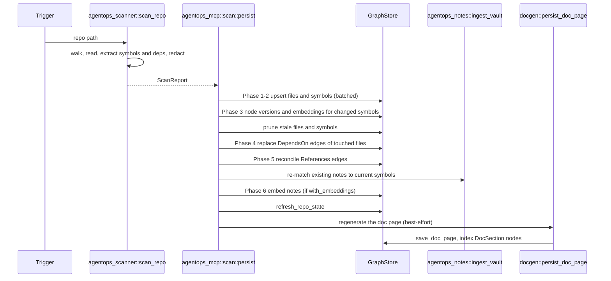

# Indexing pipeline

How a repository becomes a graph: walk, parse, persist, link notes, embed and document, and what triggers each run. Read this before changing the scanner, rescans, reindex triggers or anything that runs after a scan.

Crate-level detail is in [02-crates/indexing.md](02-crates/indexing.md) and [02-crates/use-cases-and-transports.md](02-crates/use-cases-and-transports.md); tables are in [03-data-model.md](03-data-model.md).

## Pipeline overview

Every scan, whatever triggers it, goes through one function: `agentops_mcp::scan::persist` (`agentops-core/crates/agentops-mcp/src/scan.rs`). The module doc explains why. An earlier codebase had separate CLI and MCP scan paths, which drifted; the agent-facing path kept a duplicate-node bug after the CLI path was fixed.

## Triggers

| Trigger | Entry point | Scan function | Embeddings |
| --- | --- | --- | --- |
| `agentops install` | `install` in `agentops-core/crates/agentops-cli/src/main.rs` | `scan_repo` → optional macro expansion → `persist` | `--with-embeddings` |
| `scan_repo` MCP tool (Full mode) | `agentops-core/crates/agentops-mcp/src/tools.rs` | `scan_and_persist` | `with_embeddings` argument |
| `agentops watch` | `watch_and_rescan` (`agentops-core/crates/agentops-mcp/src/watch.rs`) | `scan_and_persist` per debounced batch (500 ms) | `--with-embeddings` |
| REST `POST /repos/{name}/rescan` (dashboard button) | `rescan_repo_json`, `agentops-core/crates/agentops-api/src/repos.rs` | `scan_and_persist` on a repo from the local manifest | always on (`with_embeddings: true`) |
| Hosted connect or manual reindex | `POST /repos/{id}/index`, `/index/retry` → `create_and_spawn_job` | job pipeline below, calling `persist` | no core embeddings; Qdrant only |
| GitHub `push` webhook | `/webhooks/github` → `create_and_spawn_job(.., JobKind::Reindex)` | job pipeline below | as above |
| Linear auto-kickoff | `/webhooks/linear` (`agentops-core/crates/agentops-heavy-api/src/linear_webhook.rs`) | `scan_and_persist` for the mapped repo | — |

The `scan_repo` tool only rescans an existing working copy. For a GitHub-App-connected repo, `POST /repos/{id}/index` is what pulls the latest code (gotcha 54077, "The scan_repo MCP tool only rescans an already-checked-out working copy -- POST /repos/{id}/index is what actually pulls latest git for a github_app-connected repo").

## Walking the repo

`agentops_scanner::walk_repo` (`src/walker.rs`) yields `(path, Language)` pairs for supported source files. It uses the `ignore` crate, so `.gitignore` rules apply, but only inside a real git repository (gotcha 53927, "ignore::WalkBuilder only honors .gitignore inside an actual git repo"). Unreadable or binary files are skipped silently (`scan_repo`).

Files whose names suggest secrets are excluded (`agentops_security::is_secret_bearing_filename`).

## Parsing

| Step | Function | Notes |
| --- | --- | --- |
| Symbols | `ast_extract::extract_symbols` | tree-sitter for Python, TypeScript, JavaScript, Go, Rust, C++, C#; regex fallback when tree-sitter fails. |
| Macro sites | `collect_macro_invocation_sites` | Rust item-level macro invocations, for the optional LSP pass. |
| Imports | `dep_extract::extract_deps` | Raw import targets, resolved to files by `resolve_dependency_edges`. |
| Same-file references | `resolve_same_file_symbol_references` | AST-precise where tree-sitter parsed; word-boundary text matching otherwise. |
| Redaction | `agentops_security::redact` | Applied to symbol source and chunk text before `scan_repo` returns. |

Files where both tree-sitter and the regex fallback found nothing are returned as `fallback_gap_files`; `agentops install` prints them as a warning.

Grammars are compiled at build time from `TSLP_LANGUAGES` (`.cargo/config.toml`); the scanner never downloads at runtime (root `Cargo.toml` comment). Windows needs the C++/C# grammars built against the same CRT as Rust (gotcha 54110).

Known gaps:
- Dependency edges miss Rust `crate::` paths and tsconfig path aliases (gotcha 53987, "dependency-edge resolution gap on Rust crate:: and tsconfig aliases").
- Symbol identity can collide inside one file (gotchas 53982, 54079); `persist` dedupes before batch upserts (gotcha 54078).

## Persisting and rescans

`persist` runs these phases in order (inline comments in `persist_impl`):

1. **Files**: one batched find and one batched upsert of `File` nodes.
2. **Symbols**: batched find and upsert across all files. Each symbol is classified Added, Changed or unchanged by comparing content in memory.
3. **Versions and embeddings**: for new or changed symbols only. Each gets a `node_versions` snapshot (bi-temporal history). With `with_embeddings`, it is also embedded through `LocalEmbedder`. An unchanged symbol keeps its old embedding.
4. **Pruning**: `prune_stale_nodes` removes `File` and `Symbol` nodes not seen in this scan, and closes their open versions. It is repo-scoped, so it cannot touch another repo in a shared store.
5. **Dependency edges**: `DependsOn` edges of every touched file are deleted and recreated, not diffed.
6. **Reference edges**: re-confirmed references are reinforced (`reinforce_edges_batch`, `bump_confirmed_at: false`), vanished ones deleted, new ones added. They are plastic, not recreated at weight 1.0.

A file counts as Changed if any of its symbols changed. File nodes carry no content to diff. Every scan writes `scan_history` and `scan_history_entries`, which `agentops changelog` and `list_scans` read.

Pruning a node that still has edges fails a foreign-key check unless its edges go first (gotcha 54057).

## Note linking

After the code phases, `persist` re-matches every note in the repo's notes folder against the current symbols (`agentops_notes::ingest_vault`, "Module B" comment). This is on by default because it is in-process matching with no network or LLM cost. A repo with no notes folder is a fast no-op.

The re-match passes `bump_confirmed_at: false`. It is a passive keyword match, not a human reconfirming the note, so it must not reset the staleness clock that `get_symbol` compares against `node_history` (inline comment; gotcha 53965).

It fixes a recorded gap: notes written before the first scan never attached to any symbol (gotcha 54035, "notes written before first scan never attach to symbols").

## Embeddings

Embedding is opt-in (`with_embeddings`). The `persist` doc comment calls it "local/free of API cost but still real CPU-bound latency per symbol". When on:

- Changed symbols are embedded in phase 3.
- Notes are embedded in phase 6, in one batched `set_embeddings_batch` call. Before this step existed, rescans left Gotcha, Decision and Note nodes unembedded (gotcha 53966, "automatic rescan never embedded Gotcha/Decision/Note nodes").
- Doc sections are embedded when the doc page is indexed (`index_doc_sections`).

Hosted indexing calls `persist(.., false)`: hosted graphs get no core embeddings. Vectors go to Qdrant only, when `AGENTOPS_QDRANT_URL` is set (stage 7 below). Search on a hosted graph therefore relies on lexical and exact-name signals unless Qdrant is configured. See [05-retrieval.md](05-retrieval.md).

## Repo state and documentation

At the end of every `persist`:

1. `refresh_repo_state` stores the latest scan id and the top gotcha and decision ids ("Module C" comment).
2. `docgen::persist_doc_page` (`agentops-core/crates/agentops-mcp/src/docgen.rs`) rebuilds the Documentation Viewer page:
   - ranks files with `agentops_scanner::rank_files` (PageRank);
   - asks `agentops_llm::group_core_modules` to label core modules, **if** `AGENTOPS_ANTHROPIC_API_KEY` is set. It uses the default (not cheap) model, chosen on purpose because users read these labels directly. Without a key, or on failure, it falls back to grouping by directory name;
   - builds the page with `agentops_docgen::build_doc_page`;
   - keeps agent-authored Blueprint sections from the previous page (`persist_blueprint_doc`), which `build_doc_page` never produces itself;
   - saves the page and indexes each section as a `DocSection` node linked by `Covers` edges.

Any error in this step is logged and swallowed; it never fails the scan.

Step 2 makes a paid LLM call only when the ranked file set changed since the stored page (`module_set_hash`); otherwise it reuses the stored labels, so `agentops watch` batches and push-triggered reindexes of the same files cost nothing (ADR 0044).

`repo-map.md` is a separate output. `agentops docgen`, the `generate_docs` tool and hosted stage 8 render it with `agentops_docgen::render_onboarding_doc`.

## rust-analyzer pass

`agentops install --with-lsp` adds an optional macro-expansion pass:

1. `scan_repo` collects Rust macro invocation sites.
2. `enrich_with_macro_expansions` starts one `rust-analyzer` (`agentops_lsp_client::LspClient`) and asks it to expand each site (`rust-analyzer/expandMacro`). Handshake timeout is 60 s, per-request 30 s (`install`).
3. Each expansion is parsed by the same `extract_symbols`, so generated symbols look like hand-written ones. `persist` needs no changes.

Every failure is skipped, never fatal: a missing binary, a workspace that does not build, a timeout, or a `#[derive(...)]` macro (which `expandMacro` cannot expand). Requests rejected with `ContentModified` are retried (commit `8565155`).

A cross-file `References` step (`find_cross_file_references`) runs with `agentops install --with-lsp`, through `persist_with_lsp` (fixed for `findings.md` F25).

Decision context: the pilot's original motivation, container disambiguation, turned out mostly redundant with a tree-sitter fix (gotcha 53903). Macro expansion is the remaining value (`agentops-lsp-client` module doc).

## Watch mode

`agentops watch <path>` requires a prior `agentops install`: it fails early if no store opens. `watch_and_rescan` then debounces file events for 500 ms (`notify-debouncer-full`) and calls `scan_and_persist` on each batch. It runs until interrupted.

It watches each directory from `agentops_scanner::watchable_dirs` individually rather than recursively watching the repo root (gotcha 53999, "File watcher must never recursively watch the repo root -- watch each pruned directory individually").

## Hosted indexing

`create_and_spawn_job` starts a detached `tokio::spawn` task (`run_job`, `agentops-core/crates/agentops-heavy-api/src/indexing.rs`). Progress is recorded per stage in `indexing_jobs`, `indexing_job_stages` and `indexing_job_log`, and polled by the connect wizard through `GET /repos/{id}/index/status`.

The nine stages (`STAGE_ORDER`, `agentops-core/crates/agentops-repo-access/src/indexing_store.rs`):

| # | Stage | What happens |
| --- | --- | --- |
| 1 | `connection_verified` | Connection checked. |
| 2 | `repository_cloned` | Deletes any existing checkout, then clones fresh: SSH with the unlocked deploy key, or HTTPS with a fresh GitHub App installation token. Checks out the tracked branch. |
| 3 | `files_discovered` | `agentops_scanner::scan_repo`. |
| 4 | `symbols_extracted` | `agentops_mcp::scan::persist(.., false)` inside `spawn_blocking`. |
| 5 | `dependencies_mapped` | Reported from the same `persist` call. |
| 6 | `knowledge_nodes_created` | Reported from the same `persist` call. |
| 7 | `embeddings_generated` | `collect_index_items` + `SemanticIndex::index_items` into Qdrant; marked done instantly when Qdrant is not configured. |
| 8 | `documentation_generated` | `generate_onboarding_doc` writes `repo-map.md` into the checkout. Best-effort. |
| 9 | `index_ready` | Done. |

Checkouts live at a path stable per `(tenant, connection_id)`, so two tenants with the same connection id never collide (regression test `checkout_path_never_collides_across_tenants_sharing_a_connection_id`).

Known gaps, all from the code or its comments:
- No graceful shutdown. A job running when the process exits stays `running` forever, and the status endpoint does not correct for it (module doc).
- Without `spawn_blocking` around `persist`, a Postgres deployment panics and leaves the job `running`. This happened twice before the fix (inline comment).
- Stages 7 and 8 read the configured store (Postgres when set) under the checkout's repo key `<connection_id>--<tenant>`, and stage 8 reuses the job's PageRank ordering instead of rescanning (fixed for `findings.md` F27; gotcha 54007 is now stale).
- Each job re-clones from scratch rather than fetching.

## Push-triggered reindex

GitHub calls `POST /webhooks/github` (`agentops-core/crates/agentops-heavy-api/src/github_app_routes.rs`), mounted outside session auth.

1. The `X-Hub-Signature-256` HMAC is verified against `AGENTOPS_GITHUB_WEBHOOK_SECRET`; a bad signature gets 401. Without a configured GitHub App, the route answers 503 rather than 404.
2. The installation id is resolved to a tenant.
3. `installation` `deleted` and `installation_repositories` `removed` mark the affected connections failed.
4. `push` derives the connection id `owner--repo` from `repository.full_name`. If that misses, it falls back to a `repo_url` lookup, needed for connections upgraded in place that kept their original id (gotchas 54150, 54215). Only `GitHubApp` connections are dispatched, and the result is a `Reindex` job.
5. Other events are acknowledged with `dispatched: false`.

A push reindexes only when its `ref` is `refs/heads/<tracked_branch>`, or the repository's default branch when none is tracked; other branches and tags return `dispatched: false`. When either field is missing it reindexes as before (`pushes_tracked_ref`; fixed for `findings.md` F26).

## Open questions

None. Findings F24 to F27 are resolved.
