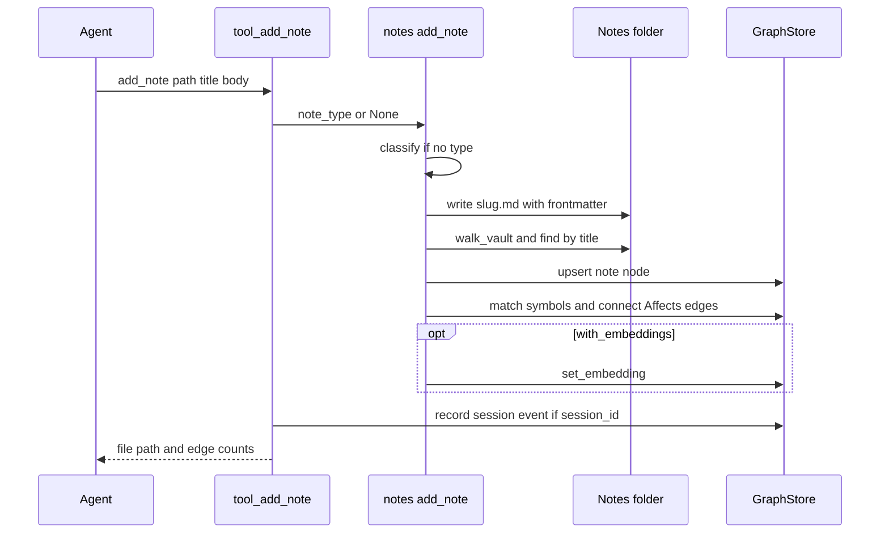
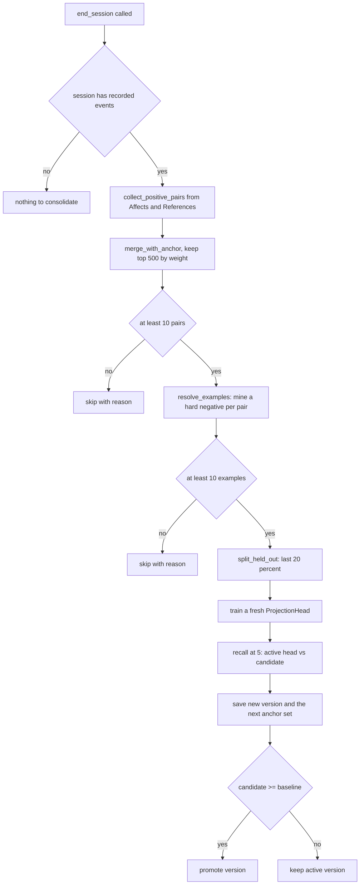

# Notes and consolidation

How gotchas, decisions and notes are recorded, attached to code, curated and kept trustworthy, and how local consolidation trains on them. Read this before changing note ingestion, symbol matching, curation, or either training crate.

Crate detail is in [02-crates/knowledge-and-retrieval.md](02-crates/knowledge-and-retrieval.md) and [02-crates/semantic-index-and-consolidation.md](02-crates/semantic-index-and-consolidation.md). Storage of the note kinds is in [03-data-model.md](03-data-model.md).

## Note types

A note is a Markdown document stored as a graph node. Its type decides its `NodeKind` (`NoteType::node_kind`, `agentops-core/crates/agentops-notes/src/vault.rs`):

| `NoteType` | `NodeKind` | Meaning (from the LLM classifier prompt in `agentops-llm`) |
| --- | --- | --- |
| `Gotcha` | `Gotcha` | A workaround, bug or known issue with existing code or behavior. |
| `Decision` | `Decision` | A choice made and why, with an alternative considered or rejected. |
| `Knowledge` | `Note` | General context that is neither of the above. |
| `Context` | `Note` | Same as `Knowledge`; accepted from frontmatter and folder names only. |

The MCP `add_note` tool accepts only `gotcha`, `decision` and `knowledge` as `note_type`.

### Classification order

`NoteType::infer` tries three signals, in order:

1. Frontmatter `type:` (`gotcha`, `decision`, `knowledge`, `context`, or their plurals).
2. The parent folder name, with the same words. `decisions/use-sqlite.md` is a decision.
3. A `NoteClassifier`, only when neither structural signal exists.

`HeuristicClassifier` is the default classifier. `heuristic_score` counts keywords from two fixed lists, `GOTCHA_KEYWORDS` ("workaround", "silently", "bug" and others) and `DECISION_KEYWORDS` ("decided to", "instead of", "rationale" and others). The higher count wins. A tie, including zero keywords, returns `Knowledge` with `confident = false`.

`LlmAssistedClassifier` (`agentops-core/crates/agentops-llm/src/lib.rs`) calls the heuristic first. It spends one API call only when the heuristic is not confident. It is used only by `agentops ingest-notes --llm-classify`.

### Title and identity

The title comes from frontmatter `title:`, else the first `# ` heading, else the file stem (`walk_vault`). A note's graph identity is its natural key: kind, the pseudo-path `vault:{source_path}` (path relative to the notes folder), and the title. Re-ingesting the same file updates the node in place (`ingest_vault` doc comment).

`add_note` derives the file name from the title (a lowercase, hyphenated slug). Two consequences follow from the code:

- Adding a note with an existing title overwrites that file and updates the same node. This is how a note is reinforced on purpose.
- Re-adding the same title with a different type overwrites the file but creates a second node of the new kind. The old node is never pruned (`findings.md` F32).

Malformed frontmatter never fails ingestion; the whole file becomes the body (`split_frontmatter`).

## Writing notes

There is one implementation behind every write path: `add_note` and `ingest_notes_dir` in `agentops-core/crates/agentops-mcp/src/notes.rs`. The module doc states the aim: "the CLI and the MCP tool can never drift apart on what adding a note actually does".

| Entry point | Calls | Classifier | Matcher |
| --- | --- | --- | --- |
| MCP `add_note` | `notes::add_note` | heuristic, unless `note_type` is given | `WordBoundaryMatcher` |
| MCP `ingest_notes` | `notes::ingest_notes_dir` | heuristic | `WordBoundaryMatcher` |
| CLI `agentops note` | `notes::add_note` | heuristic, unless `--kind` is given | `WordBoundaryMatcher` |
| CLI `agentops ingest-notes` | `notes::ingest_notes_dir` | `--llm-classify` for the LLM adapter | `--llm-match` for the LLM adapter |
| Every scan | `ingest_vault` from `scan::persist` | heuristic | `WordBoundaryMatcher` |

`add_note` does five things in order:

1. Classify the body if no type was given.
2. Resolve the notes folder and create it if missing.
3. Write `<slug>.md` with `title`, `type` and optional `tags` frontmatter. The title is YAML-escaped; a title containing `"` once failed to re-parse (inline comment).
4. Re-read the folder with `walk_vault`, find the note by title, and ingest it with `ingest_vault(.., bump_confirmed_at: true)`.
5. If `with_embeddings` is set, embed the body with `LocalEmbedder` and store it (`set_embedding`).

`ingest_notes_dir` walks the folder, ingests every note with `bump_confirmed_at: true`, and with `with_embeddings` re-embeds every `Gotcha`, `Decision` and `Note` node in the repo. The re-embedding is deliberate: `IngestSummary` carries counts, not node ids (doc comment).

`agentops ingest-notes --dry-run` still makes and records paid LLM calls when `--llm-classify` or `--llm-match` is set. Only the notes are not written (inline comment in `agentops-core/crates/agentops-cli/src/main.rs`).

### Notes folder resolution

`resolve_notes_path` (`agentops-core/crates/agentops-notes/src/config.rs`) picks the folder:

1. An explicit path (the `notes_path` tool argument or the CLI `--notes` flag).
2. `notes_path` from `<repo>/.agentops/config.json`, resolved against the repo root if relative.
3. `<repo>/.agentops/notes/` (`default_notes_path`).

`write_notes_path` edits `config.json` through a raw JSON map, so keys it does not know survive. `agentops-agents-md` writes the same path into the generated `AGENTS.md` as `NOTES_PATH`. A missing or invalid `config.json` falls back to the default and never fails.

This repo gitignores `.agentops/notes/` (`.gitignore`, "Kept locally ... just not committed").

### Write sequence

## Notes on a hosted server

When a repo is connected to a hosted server, notes go through hosted `/mcp` or `POST /tools/add_note`. The hosted `path` argument is a connection id or URL, never a literal path. `resolve_connection_path` maps it to the tenant's checkout directory, `<repo_checkouts_dir>/<connection_id>--<tenant>` (`checkout_path`, `agentops-core/crates/agentops-heavy-api/src/indexing.rs`; gotcha 54242).

So hosted `add_note` writes its Markdown file into the server-side checkout and its node into the shared store. Every indexing job deletes the checkout before cloning (`remove_dir_all` in stage 2). The note nodes and their edges survive, but the files do not. Two effects follow (`findings.md` F30):

- The every-scan re-match ("Note linking" in [04-indexing-pipeline.md](04-indexing-pipeline.md)) never sees hosted notes. A hosted note is matched to symbols only once, when it is added.
- A note added before the repo's first index finds no symbols and never attaches. This is gotcha 54035 again, on the hosted path.

Hosted `/mcp` refuses `notes_path`, so hosted notes always land in the connection's own notes folder (`HOSTED_FORBIDDEN_ARGS`, fixed in `17a0407`; `findings.md` F31).

### Local-file guard

`docs/vault-protocol.md` defines how agents record notes. In short: if `.context/agentops-remote.json` exists, the repo is connected to a server, and the only correct write path is `add_note` or `ingest_notes`. A local Markdown file in that case is an orphan no dashboard will show. Only without the marker may an agent write a note file under `NOTES_PATH`.

`.claude/hooks/block-local-notes.sh` enforces this for Claude Code. It is a `PreToolUse` hook on `Write` and `Edit`. It denies any write whose path contains `/.agentops/notes/` while the marker exists. Its header states why a hook exists: the prose rule "has been silently ignored by agents/subagents repeatedly".

The CLI's own `agentops note` is not covered by the hook. It always writes locally.

## Symbol matching

`WordBoundaryMatcher` is the default `SymbolMatcher`. It calls `match_symbols`, which runs a `\b<name>\b` regex for every `Symbol` name in the repo against the note body (`match_names_in_text`). Three filters apply:

| Rule | Value | Why (doc comment) |
| --- | --- | --- |
| Minimum name length | 4 (`WordBoundaryMatcher::default`) | Avoids short-name collisions. |
| Frequent names excluded | more than 3 symbols with that name (`MAX_NAME_OCCURRENCES`) | Framework names such as `GET`/`POST` route handlers are noise. |
| Ordering | longest name first | A more specific match wins over a substring collision. |

A note can match many symbols. Each match becomes an `Affects` edge from the note to the symbol (`connect_many`). The direction is load-bearing: `agentops-docgen` reads it for gotcha badges (doc comment on `EdgeRelation::Affects`).

`LlmAssistedMatcher` narrows the word-boundary candidates with one cheap-model call. It never adds a symbol the regex did not find. It runs only under `agentops ingest-notes --llm-match`.

The same matcher core, `match_same_file_references`, also builds `References` edges for files tree-sitter could not parse ([04-indexing-pipeline.md](04-indexing-pipeline.md), "Persisting and rescans").

## Reinforcement and staleness

`connect_many` adds an edge if none exists. If the edge exists, it calls `reinforce_edge`, which raises `weight` by 0.5, capped at 5.0 (`SqliteGraphStore::reinforce_edge`). Effective weight then decays with a 30-day half-life for `Affects` ([03-data-model.md](03-data-model.md), "Edge decay").

`reinforce_edge`'s `bump_confirmed_at` flag decides whether `updated_at` moves to now:

| Caller | `bump_confirmed_at` | Reason |
| --- | --- | --- |
| `add_note`, `ingest_notes`, CLI equivalents | `true` | A person or agent explicitly re-recorded the note. |
| Every-scan re-match in `scan::persist` | `false` | A blind keyword match is not a reconfirmation. |

Every scan still raises the weight of every note-to-symbol pair that matches again. Only the timestamp is protected.

`get_symbol` uses that timestamp to flag a possibly stale note (`tool_get_symbol`, `agentops-core/crates/agentops-mcp/src/tools.rs`). The test: does the symbol have a version in `node_history` whose `valid_from` is newer than the edge's `updated_at`? If so, the code changed after the note was last confirmed. The note is shown with "⚠ possibly stale".

Gotcha 53965 records why the flag matters. Before the fix, the automatic re-match refreshed `updated_at` on every scan, so no note could ever look stale.

`ingest_notes` passes `true` for every note in the folder. A bulk re-ingest therefore marks every matched note as freshly confirmed, including notes nobody re-read.

`get_symbol` orders the notes that affect a symbol by `effective_weight(weight, age_days(updated_at)) × prominence_rank_multiplier`.

## Curation

Notes are permanent knowledge. They are never deleted or resolved; their prominence is curated instead. Decision "Gotchas are curated, never resolved/dismissed -- don't reintroduce a bug-tracker model" set this rule; the fields are described in [03-data-model.md](03-data-model.md), "Curation".

| Prominence | Effect |
| --- | --- |
| `Full` | Default. |
| `Reduced` | Ranked ×0.1 everywhere it is ranked. Requires a non-empty reason, which is shown next to the note. |
| `Pinned` | Normal ranking, plus included in the sticky context `get_session_guide` returns (`nodes_pinned`). |

Curation is set only through REST:

| Surface | Route | Handler |
| --- | --- | --- |
| Single-operator `agentops-api` | `POST /repos/{name}/nodes/{id}/curation` | `set_curation_json` (`agentops-core/crates/agentops-api/src/search.rs`) |
| Hosted `agentops-heavy-api` | `POST /repos/{id}/nodes/{node_id}/curation` | `set_curation_json` (`agentops-core/crates/agentops-heavy-api/src/dashboard.rs`) |

Both reject `reduced` without a reason (HTTP 400). The web Gotchas screen drives them (`apps/web/src/app/(app)/gotchas/page.tsx`). No MCP tool changes curation. An agent can record a note, but only a person in the dashboard, or a REST client, can demote or pin one.

Curation survives rescans because `upsert_node` never writes the curation columns. `agentops migrate-graph` copies them explicitly (`set_curation` in `agentops-core/crates/agentops-cli/src/main.rs`).

How each surface shows a `Reduced` note:

- `list_gotchas` lists every gotcha, `Reduced` last, with "⚠ reduced prominence — <reason>".
- `get_symbol` shows the same marker and sorts by damped weight.
- Hybrid search and the hosted `/local-search` multiply the rank by `prominence_rank_multiplier` ([05-retrieval.md](05-retrieval.md), "Prominence dampening").
- LoRA training examples are weighted by it (`TrainingExample.weight`).

## Consolidation overview

Consolidation is the "Part B" of decision "CLS-inspired cleanup/optimization/local-consolidation plan (Initiatives 0-6) fully shipped". It trains small local models from the graph's own reinforced edges and curated notes. Both crates share one shape: a frozen base model, a small trainable adapter and held-out evaluation. A candidate is promoted only if it does not score lower than the active version.

| | Embedding consolidation | Generative consolidation |
| --- | --- | --- |
| Plan name | Initiative 5 | Initiative 6 |
| Crate | `agentops-embeddings-train` | `agentops-heavy-consolidate` |
| Base model | `LocalEmbedder` (BGE-small, 384 dimensions) | `Qwen/Qwen2.5-Coder-0.5B-Instruct` (`MODEL_ID`) |
| Adapter | `ProjectionHead`, residual MLP, `HIDDEN_DIM = 128` | Hand-rolled LoRA, `LORA_RANK = 16`, `LORA_ALPHA = 32.0` |
| Training data | `Affects`/`References` edge pairs plus a mined hard negative | One `(prompt, target)` pair per curated note's `Affects` edge |
| Minimum data | 10 resolved pairs (`MIN_REPLAY_PAIRS`) | 5 examples (`MIN_EXAMPLES`) |
| Cap per run | 500 pairs (`MAX_REPLAY_PAIRS`) | 30 examples (`MAX_EXAMPLES`) |
| Eval metric | recall@5 | Mean cosine similarity of a generation to the note text |
| Trigger | MCP `end_session` (Full) | MCP `consolidate_model` (stdio with Qdrant), `POST /consolidate/model` |
| Used by | Hybrid search, through `EmbeddingProjector` | Nothing yet (`findings.md` F29) |
| Artifacts | `~/.agentops/models/{repo}/proj_head_v{N}.safetensors` | `~/.agentops/models/{repo}`, `active_model_version` file |

Both artifact folders ignore `AGENTOPS_DATA_DIR` (`findings.md` F16). Both crates are the only places `candle-core`/`candle-nn` enter the build; training must not leak into the inference path (`agentops-embeddings-train` module doc).

Too little data is a normal state for a young repo. Both functions return a report with `attempted: false` and a reason, never an error.

## Embedding consolidation

`consolidate(store, repo, scope)` (`agentops-core/crates/agentops-embeddings-train/src/lib.rs`) runs one pass:

Steps in detail:

- **Replay pairs.** `collect_positive_pairs` takes every `Affects` and `References` edge, weighted by `effective_edge_weight`. Weight enters the loss, not the sampling, so the step needs no random numbers (doc comment).
- **Anchor set.** `merge_with_anchor` mixes in up to 200 pairs (`ANCHOR_SIZE`) saved by the previous run. A current pair overrides a stale anchor copy. The top 200 of the merged pool become the next anchor set, saved whether or not the candidate is promoted.
- **Hard negatives.** `resolve_examples` searches the anchor's 10 nearest neighbors (`NEGATIVE_SEARCH_K`). It picks the nearest one that is neither the positive nor connected to the anchor. Pairs without embeddings are dropped. Embedding consolidation therefore needs a repo indexed with `with_embeddings`.
- **Training.** `train::train` uses a weighted triplet margin loss: `weight × relu(margin − cos(anchor, positive) + cos(anchor, negative))`. Defaults (`TrainConfig::default`): 30 epochs, learning rate 1e-3, margin 0.2. Each run trains a fresh head; it does not continue the active one.
- **Zero init.** The head's second linear layer starts at zero, so an untrained head is an exact no-op. Random init made a test flaky (gotcha 53969).
- **Evaluation.** `split_held_out` holds out the last 20% by index, deterministically. `recall_at_k` counts a hit when the positive ranks in the top 5 among all embeddings of the run's examples. The baseline is the active head, or the raw embeddings if none was promoted.

`end_session` passes `scope: None`, so it trains on the whole repo's edges, not only the session's. `SessionEvent.description` is free text, so the session's node ids cannot be recovered reliably. Narrowing would need a structured `node_ids` column (`run_embedding_consolidation` doc comment, `agentops-core/crates/agentops-mcp/src/consolidate.rs`).

The decision note records the live result on this repo: recall@5 rose from 0.029 (raw) to 0.087 (projected).

### Using the projection

Hybrid search loads the active head with `load_active_projector(repo)` and passes it as `&dyn EmbeddingProjector`. `agentops-retrieval` never depends on the training crate (decision "agentops-retrieval must never depend on agentops-embeddings-train directly -- EmbeddingProjector is a plain trait for exactly this reason"). If projection fails, `LoadedProjector::project` returns the raw embedding instead of failing the search. Details are in [05-retrieval.md](05-retrieval.md), "Projection re-rank".

### When it runs

Only the `end_session` MCP tool runs embedding consolidation. It is Full-only, so it is hidden in the default Advisor mode. Nothing in the repo calls it automatically: no hook, CLI command or generated agent instruction mentions `end_session`. It also refuses to run unless the given `session_id` has recorded events in this repo.

## Generative consolidation

`consolidate_model(store, repo)` (`agentops-core/crates/agentops-heavy-consolidate/src/lib.rs`) fine-tunes a LoRA adapter on the repo's curated notes:

1. **Examples.** `generate_examples` builds one example per `Affects` edge from a `Gotcha` or `Decision` to a symbol. The prompt is a ChatML turn containing the symbol's code plus up to 5 pattern-completed related notes (`PATTERN_COMPLETE_K`, via `agentops_retrieval::pattern_complete`). The target is the note's own text. Weight is `effective_edge_weight × prominence_rank_multiplier`. Highest weight first, up to 30.
2. **Base model.** `fetch_model_files` downloads the model once. The download is explicit, never automatic, under the same "opt-in, real cost" rule as `explain_symbol` (`src/download.rs`).
3. **Baseline.** Load the base model with the active adapter, or a zero adapter if none was promoted, and score the held-out split.
4. **Candidate.** Load a fresh model with a zero-initialized adapter and train it (`TrainConfig::default`: 3 epochs, learning rate 1e-4, `max_seq_len` 512).
5. **Gate.** Generate greedily, up to 64 tokens (`DEFAULT_MAX_NEW_TOKENS`). Embed the output and the note text with the frozen `LocalEmbedder`, not the trained projection, so the eval cannot reward drift toward that projection. Promote if `candidate_score >= baseline_score`.

LoRA is hand-rolled because `candle-lora` was never published to crates.io. `B` starts at zero so a new adapter is an exact no-op (`src/lora.rs`; gotcha 53970).

### Cost

Gotcha 53983 records the cost. A run at full defaults (30 examples, 3 epochs, 64 eval tokens) was still running after 45 minutes on CPU and was abandoned. One gradient step took about 18 s. A reduced run (6 examples, 1 epoch, 4 tokens) took about 10 minutes.

`consolidate_model` has no access-mode gate: `agentops-heavy-mcp` has none (`questions.md` Q6). It is reachable on stdio when `AGENTOPS_QDRANT_URL` is set, and over REST at `POST /consolidate/model`. It is not on hosted `/mcp`, which excludes all heavy-mcp tools.

### Deferred work

The decision named in "Consolidation overview" lists three items as "deliberately deferred, not silently dropped":

- A local-first `explain_symbol` that uses the promoted adapter and falls back to Anthropic.
- A `GET /repos/{name}/consolidation-status` endpoint for both initiatives.
- An `agentops consolidate --model` CLI command.

The decision gives the paid-tier boundary as the reason for the first and third: open-core crates could not depend on `agentops-heavy-consolidate`. The open-core merge removed that boundary (`questions.md` A-2). None of the three exists yet. Until the first does, a promoted adapter is written to disk and read by nothing except the next run's baseline (`findings.md` F29).

## No-regression gate

Both gates promote a candidate when its score is greater than or equal to the active version's score on the run's held-out split. A regression is a strictly lower score.

| | Embeddings | LoRA |
| --- | --- | --- |
| Held-out split | last 20% of resolved examples, by index | last 20% of examples, by index |
| Fewer than 5 examples | train and eval on the same set | cannot happen (`MIN_EXAMPLES = 5`) |
| Baseline | active head, or raw embeddings | active adapter, or zero adapter |
| Metric | recall@5 against the run's own example pool | mean cosine to the note text under the frozen embedder |
| Tie | promotes | promotes |

The held-out split is drawn fresh from each run's data, so two runs' scores are not comparable. The LoRA module doc says the gate "reduces regression risk, it does not guarantee quality". Whether a tie should promote is open (`questions.md` Q7).

## Librarian

`agentops librarian` (`agentops-core/crates/agentops-cli/src/librarian.rs`) evaluates whether a cheap model can sort recorded gotchas into portable and project-specific ones. It is evaluation-only; nothing writes back to the graph (`agentops-llm/src/librarian.rs` module doc).

| Step | Command | Output |
| --- | --- | --- |
| Export | `agentops librarian export-labels` | `notes.json` (full gotcha bodies from the remote server, read-only GETs) and `labels.csv` with blank `scope`/`technology` columns for a person to fill in |
| Evaluate | `agentops librarian dry-run` | `report.json`, `report.md`: accuracy against the labels, JSON validity, tokens, cost and latency per model in a `models.toml`, and pass/fail against optional thresholds |

Each model must classify 5 notes cleanly before the full run (`SMOKE_GATE`). The verdict (`LibrarianVerdict`) holds `scope`, `technology`, `version`, a project-neutral title and body, and a rationale. Spend is measured with `UsageRecorder` but not persisted. `.gitignore` excludes the exported files, which contain full gotcha bodies.

## Open questions

- [Q6](questions.md): why `persist_blueprint_doc`, hosted `unregister_repo`, the docbrain writes and `consolidate_model` are open in Advisor mode. `ingest_notes` now has a stated reason: the same as `add_note` (comment on its `ToolSpec`).
- [Q7](questions.md): whether a tie on either gate should promote.
- [Q13](questions.md): whether the LoRA deferrals still stand now that the tier boundary is gone (`findings.md` F29).
