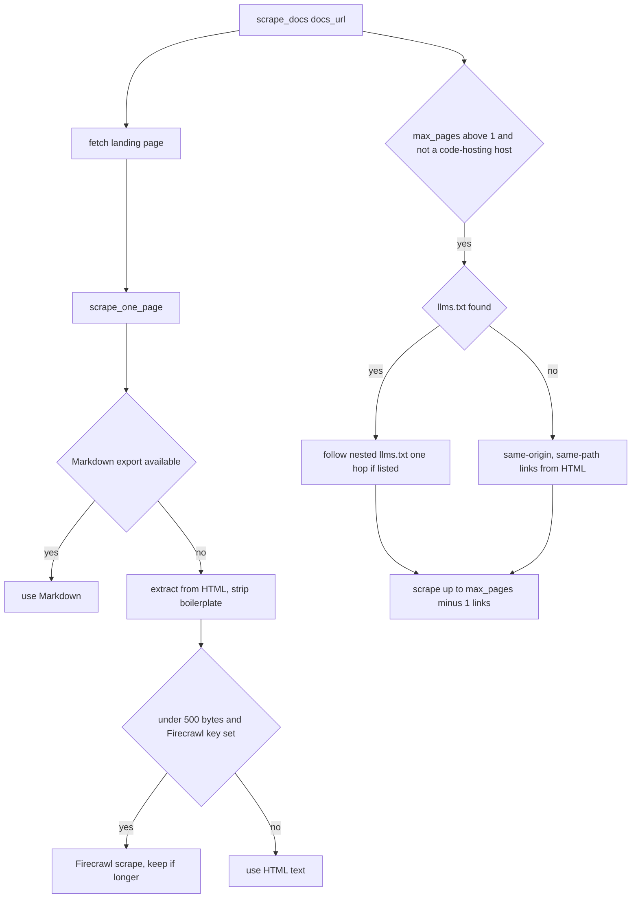

# docbrain

How AgentOps registers third-party libraries, scrapes their documentation into a version-pinned graph, and serves it to agents within a token budget. Read this before changing discovery, scraping, chunking, doc search or changelogs.

Crate detail is in [02-crates/docbrain.md](02-crates/docbrain.md). Table definitions are in [03-data-model.md](03-data-model.md), "docbrain schema". The tools are listed in [07-mcp-and-rest-contracts.md](07-mcp-and-rest-contracts.md), "docbrain tools".

## Model

docbrain stores one graph per SQLite file, behind the `DocbrainStore` port (`docbrain-core/crates/docbrain-graph/src/lib.rs`). It has no `repo` dimension; the unit is a library.

| Entity | Table | Identity | Meaning |
| --- | --- | --- | --- |
| `Library` | `libraries` | `slug`, unique | A package, with a name, optional `docs_url`, GitHub repo and description. |
| Snapshot | `doc_snapshots` | library + version | Records that a version was scraped. |
| `DocNode` | `doc_nodes` | library + version + `content_hash` | One token-bounded chunk, `Prose` or `CodeExample`, with a `topic` (its heading). |
| `DocEdge` | `doc_edges` | from + to + relation | A "synapse" between chunks. |
| `ChangelogEntry` | `changelog_versions` | library + `from_version` + `to_version` | One consecutive release pair and its notes. |
| `Job` | `jobs` | id | A background scrape or changelog sync: `Running`, `Succeeded` or `Failed`. |
| `RepoLibraryUsage` | `repo_library_versions` | repo + library | The version a scanned repo's manifest declares. |

Vectors live in the sqlite-vec table `doc_node_vectors`, at the same 384 dimensions as the code graph (`EMBEDDING_DIM`). docbrain embeds with `agentops_embeddings::LocalEmbedder`, the same local model the code graph uses.

Edge relations:

| `EdgeRelation` | From → to | Built by |
| --- | --- | --- |
| `Sequence` | a chunk → the next chunk on the page | `chunk_and_store`, page order |
| `ParentSection` | a section → its parent heading's section | `chunk_and_store`, heading levels |
| `CrossReference` | a chunk → the chunk a same-page anchor link points to | `chunk_and_store`, after all topics are known |
| `HasExample` | a prose chunk → a code block cut out of it | `extract_code_blocks` |

The edges exist so retrieval can return "directly connected context instead of isolated top-k chunks" (`docbrain-graph` module doc).

docbrain is single-tenant by design. Multi-tenancy is one file per tenant, handled outside the port ("Multi-tenancy" below).

## Discovery and registration

A library enters the store in one of three ways:

| Path | Entry point | Source of metadata |
| --- | --- | --- |
| Agent or person names it | `register_library` tool | The caller's `slug`, `name`, `docs_url`. |
| Agent asks for a package | `discover_library` tool | `RegistryDiscovery`, then `add_library` if found. |
| A repo's manifests | `agentops sync-docs` (CLI), Linear auto-kickoff | `agentops_mcp::sync_docs` over the scanner's declared dependencies. |

`RegistryDiscovery` (`docbrain-core/crates/docbrain-ingest/src/discover.rs`) queries the package registry first and falls back to GitHub repository search. `Ecosystem` covers `Npm`, `PyPi`, `Cargo`, `Go` and `NuGet`. C++ is left to `register_library`, because it has no single dominant package manager (enum doc comment).

Two protections were added over the pre-rebuild code (module doc):

- GitHub search throttles itself in front of each call, because unauthenticated search allows 10 requests a minute.
- Results are cached for the life of the process.

`classify_dependency` (`src/classify.rs`) decides whether an import is a real third-party package and which registry owns it, before discovery runs.

`agentops_mcp::sync_docs` (`agentops-core/crates/agentops-mcp/src/sync_docs.rs`) runs the two automatic discovery steps and records manifest-declared versions in `repo_library_versions`. It records versions only for libraries already in the store. The CLI adds a third, interactive step: asking a person about anything still unresolved.

`register_library` does not fetch anything. Registration stores metadata only; scraping is a separate, explicit call.

## Scraping

`scrape_library(slug, version, max_pages, background)` fetches the library's registered `docs_url` and stores it under the given version. The version is the caller's label; docbrain does not verify it against the site.

Per page (`scrape_one_page`, `docbrain-core/crates/docbrain-ingest/src/scrape.rs`):

1. **Markdown export.** `fetch_markdown_export` tries `Accept: text/markdown`, checking the response's real `Content-Type`, then a `.md` suffix. The module doc measured a ~200 KB HTML page against a ~600-byte Markdown export of the same content.
2. **HTML fallback.** `extract_page` skips `nav`, `header`, `footer`, `aside`, `script`, `style` and `button` subtrees. It prefers `<main>` or `<article>` over `<body>`. Headings `h1`–`h4` become `#` lines so the chunker can split on them.
3. **Firecrawl fallback.** If the HTML text is under 500 bytes (`LIKELY_JS_SHELL_BYTES`) and a Firecrawl key is available, `fetch_via_firecrawl` asks Firecrawl's `/v1/scrape` to render the page. Its result is kept only if longer.

Link following (`max_pages` > 1):

- **`llms.txt` first.** `fetch_llms_txt_links` tries `<docs_url dir>/llms.txt`, then `/llms.txt`, then `/docs/llms.txt`. If that file links to a more specific `llms.txt`, it follows that one hop deeper. A site's root index often mixes docs with blog and marketing links; Next.js's does (inline comment). Decision "docbrain's shallow crawl now prefers a site's llms.txt over blind HTML link-scraping".
- **HTML links otherwise.** `same_scope_links` keeps same-origin links under the docs URL's path, without query or fragment.
- **No crawl on code hosts.** For `github.com`, `gitlab.com` and `bitbucket.org` only the landing page is scraped. A 200-page crawl of a GitHub repo once produced ~1,625 chunks of error placeholders and commit history (inline comment).
- A failed follow-up page is logged and skipped; the landing page still counts.

`max_pages` defaults to 1 and is capped at 200 (`MAX_SCRAPE_PAGES`).

### Firecrawl key

Firecrawl is optional and paid. The key comes only from the tenant's integrations vault: hosted `call_docbrain_tool` injects it as the undeclared `_firecrawl_api_key` argument (`agentops-core/crates/agentops-heavy-api/src/mcp_http.rs`). A vault error is logged and the scrape proceeds without the fallback, so a broken vault is not mistaken for "no key" silently (inline comment). The CLI and stdio paths have no vault, so they never use Firecrawl. Added in `c2ef9a8`.

### Background jobs

With `background: true`, `scrape_library` creates a `jobs` row, starts a `std::thread`, and returns the job id at once. `get_job_status` polls it. The thread opens its own store from `db_path`. If that open fails, the job row stays `Running` forever. A stress test hit this in 2 of 68 concurrent jobs, so it is now at least logged (comment in `run_scrape_job`). `sync_changelogs` uses the same pattern.

## Chunking

`chunk_and_store` (`docbrain-core/crates/docbrain-ingest/src/chunk.rs`) turns pages into nodes and edges:

1. **Code first.** `extract_code_blocks` moves every fenced code block into its own `CodeExample` node, linked from its prose by `HasExample`. A code block can therefore never be cut in half by the token splitter.
2. **Headings are hard boundaries.** `split_into_sections` splits at every `#`–`######` line. Two sections are never merged, however small. Text before the first heading becomes a level-0 section. Its topic is the Markdown export's frontmatter title, else "overview".
3. **Token cap second.** Only a section over 500 tokens (`MAX_CHUNK_TOKENS`) is split further, by `text_splitter`'s `MarkdownSplitter`, counting `cl100k_base` tokens. That count is "a practical token-budget proxy, not a claim of exact Anthropic tokenization" (module doc).
4. **Dedup.** Each chunk is upserted on `(library, version, content_hash)`. A re-scrape inserts only new content.
5. **Edges.** `Sequence` and `ParentSection` are added as chunks are created; `CrossReference` after all topics are known.
6. **Embeddings.** Each chunk is embedded before its upsert, including chunks that already exist. Vectors go to `doc_node_vectors`.

The heading-first order fixed a real defect. Token-first splitting merged small sections, so a node's topic named only its first heading while its content held unrelated sections (module doc).

A topic is capped at 200 characters (`MAX_TOPIC_CHARS`, `cap_topic`). A page with almost no newlines once turned its first `#` line into a ~3.9M-character topic that bypassed every token budget (gotcha 54239). Nodes stored before the cap are capped again on read (`bounded` in `src/retrieve.rs`).

## Retrieval

All three reads are in `docbrain-core/crates/docbrain-ingest/src/retrieve.rs`, not in the tool handlers. Handlers parse, call the use case and format; no business logic (module doc).

| Tool | Function | Default budget | Scope |
| --- | --- | --- | --- |
| `get_docs` | `get_docs` | `max_tokens` 2,000 | One `slug@version`, in storage order. |
| `search_docs` | `search_docs` | `top_k` 5, `max_tokens` 1,500 | All libraries, or one `slug`; **all versions**. |
| `get_code_examples` | `get_code_examples` | none | The `CodeExample` nodes linked from one prose node. |

Rules shared by `get_docs` and `search_docs`:

- **Prose by default.** `CodeExample` nodes are excluded unless `include_examples`. This is the "planning/implementation split": plan with prose, then fetch exact code with `get_code_examples` (`chunk.rs` module doc). The result says how many examples were hidden.
- **Budget accounting.** A node's cost is the larger of its stored `token_count` and `content.len() / 4` (`cost_of`). The floor exists because a stored count once understated two ~3.9M-character nodes.
- **Oversized first node.** If the first node alone exceeds the budget, it is cut to fit with a "[truncated ... narrow the query]" marker (`truncate_node`). Later oversized nodes end the result.
- **Not found.** `get_docs` for an unscraped version returns the versions that do exist.

`search_docs` adds edge expansion. For each vector hit within budget, it pulls every directly connected node through any edge relation. A neighbor is skipped if it does not fit or is an excluded code example. Results show each hit's distance, or the relation it was reached by.

`search_docs` filters by `slug` only, not by version. A library scraped at two versions returns hits from both, labelled by topic and node id but not by version.

## Changelogs

`sync_changelogs(slug, github_token, background)` reads GitHub releases for the library's `github_repo` (`GitHubReleasesSync`, `docbrain-core/crates/docbrain-ingest/src/changelog.rs`):

- It follows the `Link: rel="next"` header, up to 5 pages of 100 releases (`MAX_PAGES`). Deeper pages make GitHub return 422 on repos like `vercel/next.js`, with thousands of canary releases (gotcha 54002).
- It drops drafts and prereleases and strips a leading `v` from tags.
- It pairs each release with the one before it. One `ChangelogEntry` per consecutive pair, holding the newer release's notes.
- `breaking` is a heuristic: the notes contain "breaking", or the major version increased (`is_breaking`).
- The optional token raises GitHub's unauthenticated limit of 60 requests an hour.
- Re-sync is idempotent: `add_changelog_entry` upserts on library + both versions.

`get_changelog(slug, from_version, to_version)` matches that exact pair only. A range such as 13.0 to 15.0 returns nothing; `list_changelog` shows the stored pairs. Release tags rarely match the version labels docs were scraped under (gotcha 53990), so the two version lists are not joined.

The web Libraries screen marks a library whose repo-declared version differs from its scraped versions (`has_mismatch`, ported into `agentops-core/crates/agentops-heavy-api/src/libraries_http.rs`).

## Semantic-index path

docbrain content can also be indexed into Qdrant, separately from its own sqlite-vec search:

- `index_docs_indexed` and `search_docs_indexed` (semantic-index tools, stdio with Qdrant) use `collect_doc_index_items` and the BGE-M3 plus reranker pipeline in `agentops-heavy-embeddings`.
- Hosted REST has `POST /docs/search/index` and `GET /docs/search`, scoped to the tenant's docbrain file.

The `agentops-mcp-server` module doc notes these "may turn out to be redundant" with `search_docs`. Search quality differences are described in [05-retrieval.md](05-retrieval.md), "Semantic index path (Qdrant)".

## Multi-tenancy

| Surface | Store | Path |
| --- | --- | --- |
| stdio `agentops-mcp-server`, CLI `docbrain-serve` | one file | `docbrain_mcp::default_db_path()`: `AGENTOPS_DOCBRAIN_DB`, else `<AGENTOPS_DATA_DIR>/docbrain.db` |
| CLI `sync-docs` without `--db` | two files, possibly | discovery writes the hardcoded `~/.agentops/docbrain.db`; the interactive step uses `docbrain_mcp::default_db_path()` (`findings.md` F36) |
| Hosted `/mcp` docbrain tools | one file per tenant, opened per call | `docbrain_db_path_for_org`: `<DOCBRAIN_DB_DIR>/<tenant>.db`, default `<AGENTOPS_DATA_DIR>/docbrain-tenants/` |
| Hosted `/libraries`, `/libraries/{slug}`, `/libraries/tools/{name}` | same per-tenant file | `libraries_http.rs`, gated by `CAP_LIBRARIES_VIEW` |
| `/docbrain/*` on `agentops-server` | one global file, opened at start | `docbrain_mcp::default_db_path()`, instance key only |

Decision "Multi-tenant docbrain isolation via one SQLite file per tenant, not a TenantContext" chose files over a tenant column. `SqliteDocbrainStore` is not `Sync`, so `docbrain-api` keeps it behind a mutex and holds the lock for one call.

`/docbrain/*` still serves the single global store (gotcha 30341). Hosted users reach their own data through `/libraries*` and `/mcp`; `/docbrain/*` needs the instance key.

### Known gaps

- **Self-seed.** `agentops_server::run` registers `agentops` as a library in the global store at every boot. Hosted orgs read their own files, so they never see it; `README.md` and `llms.txt` now say so (`findings.md` F3, won't fix). The author decided AgentOps's own docs will not be registered (`questions.md` A-1).
- **Linear auto-kickoff.** `linear_webhook.rs` passes the tenant's own docbrain file (`docbrain_db_path_for_org`) to `agentops_mcp::sync_docs`. Without a path, `sync_docs` resolves the store like `docbrain_mcp::default_db_path`: `AGENTOPS_DOCBRAIN_DB`, then `AGENTOPS_DATA_DIR` (fixed for `findings.md` F36).
- **Outbound fetches** (fixed in `ffd9c1e`). Page fetches go through `DOC_AGENT` (`docbrain-core/crates/docbrain-ingest/src/net.rs`), whose `PublicOnlyResolver` refuses loopback, private, link-local, CGNAT and other non-public addresses on every connection. `docs_url` must be http(s), `max_pages` is capped at 200, and at most 4 background jobs run at once. `AGENTOPS_ALLOW_PRIVATE_DOC_URLS` turns the address check off for intranet docs (`findings.md` F35).

## Open questions

None. Q6 was answered: `scrape_library` and `sync_changelogs` are Full-only on hosted `/mcp`, and need `libraries.manage` on the web (ADR 0041). Findings F7, F22, F35 and F36 are resolved; F3 is won't fix.
