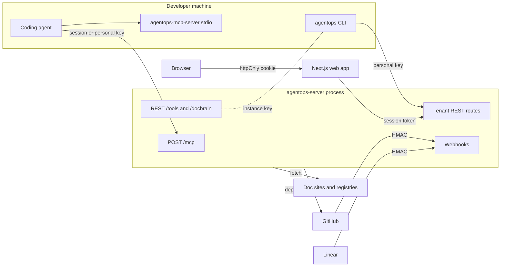
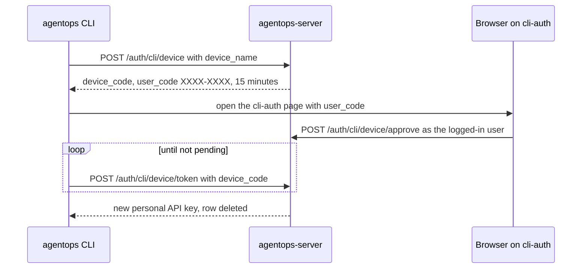

# Auth, teams and security

Who can call what, how each caller proves who it is, and how secrets and repo credentials are protected. Read this before touching authentication, roles, API keys, the MCP access mode, or any route reachable from the network.

Crate detail is in [02-crates/accounts-teams-integrations.md](02-crates/accounts-teams-integrations.md) and [02-crates/foundations.md](02-crates/foundations.md). Tool-level access rules are in [07-mcp-and-rest-contracts.md](07-mcp-and-rest-contracts.md).

> **Open security findings.** `findings.md` F31, F35, F37 and F38 describe exposures on the hosted server. They are confirmed by reading code, not tested live. Keep those entries out of public commits until fixed (`SECURITY.md`).

## Trust boundaries

| Boundary | Trusted side | Rule |
| --- | --- | --- |
| Local stdio MCP | The developer's own process | `path` is a literal filesystem path. No auth. |
| Hosted `/mcp` | Server | Caller is a session or personal API key. `path` is resolved inside the caller's tenant (`resolve_connection_path`). |
| Tenant REST routes | Server | Session or personal key gives a server-derived tenant. The instance key gives full access to a client-named tenant. |
| `/tools`, `/docbrain/*` | Server | Instance key only. Operator surface with literal paths. |
| Browser | Web app | The session token lives in an httpOnly cookie and never reaches browser JavaScript (`apps/web/src/lib/auth/session.ts`). |
| Webhooks | Server | HMAC signature header, no bearer token. |
| Outbound fetches | Remote sites | Scraping, registries, GitHub releases, LLM APIs. Responses are untrusted content. |

## Callers and credentials

| Credential | Issued by | Stored as | Identifies | Accepted by |
| --- | --- | --- | --- | --- |
| Session token | `POST /auth/login`, `POST /auth/signup` | hash in `sessions`, 30 days (`SESSION_LIFETIME_DAYS`) | a user | tenant REST routes, `/mcp` |
| Personal API key | `POST /auth/api-keys`, device flow | hash in `user_api_keys` | a user and their tenant | tenant REST routes, `/mcp` |
| Instance API key | `agentops api-key generate` | `AGENTOPS_API_KEY_HASH` env var | no user, no tenant | tenant REST routes, `/tools`, `/docbrain/*` |
| Login challenge | password step of a 2FA login | hash in `login_challenges` | a half-finished login | `POST /auth/login/2fa` only |
| Webhook secret | GitHub App, Linear | config and vault | the sender | `/webhooks/github`, `/webhooks/linear` |

All tokens and keys are random, opaque, hashed at rest and looked up by hash. They reuse `agentops_security::api_key` (`agentops-core/crates/agentops-accounts/src/lib.rs` module doc). Raw values are shown once.

### How a request is authenticated

`require_api_key_or_session` (`agentops-core/crates/agentops-heavy-api/src/lib.rs`) gates the tenant REST routes. It tries, in order:

1. A session token → the `User` is attached to the request.
2. A personal API key → its owner's `User` is attached. The user's *current* tenant applies, not the tenant the key was created in. `/mcp` uses the key's own tenant instead (`resolve_tenant_caller`).
3. Otherwise `require_api_key`: the instance key, checked by `check_bearer_api_key`.

`resolve_tenant` then decides the tenant. With a `User`, the tenant comes from the user and any client-supplied value is ignored. So "a session can't spoof another tenant by editing a query param" (doc comment). Without a `User`, the request must name a `tenant` itself.

`require_session_capability` checks the role matrix only on the session path. With no `User` it returns OK: "a valid API key already implies full access" (doc comment).

`/mcp` uses `require_tenant_auth` instead (`agentops-core/crates/agentops-heavy-api/src/tenant_repo.rs`). It accepts a session or personal key only, never the instance key, because the instance key carries no tenant.

### Unset instance key

`check_bearer_api_key` returns OK when no hash is configured. `.env.example` says it plainly: "unset means the REST API is unauthenticated". In a multi-tenant deployment that combines with the rules above. An anonymous request reaches step 3, passes, names any `tenant`, and skips every capability check. `/tools` and `/docbrain/*` are then open with literal paths too (`findings.md` F37).

Nothing at start-up requires the hash when accounts are enabled. `agentops-server` prints no warning; only the standalone `agentops_api::run` does.

## Accounts and sessions

`AccountStore` (`agentops-core/crates/agentops-accounts/src/lib.rs`, file `accounts.sqlite`):

- **Passwords** are hashed with Argon2.
- **Signup** follows `AGENTOPS_SIGNUP_MODE`: `open` or `first-user-only`. An `invite_token` lets a person sign up when signup is otherwise closed. Signup does not accept the invite; the user accepts it separately (decision "Signup's invite_token gates open signup, but must NOT accept/consume the invite itself").
- **Sessions** last 30 days. The web app sets the cookie `httpOnly`, `sameSite: lax`, with `secure` only when the request arrived over HTTPS. Keying `secure` on `NODE_ENV` broke logins on plain-HTTP self-hosts silently (gotcha 54081).
- **Two-factor** is TOTP. The secret is encrypted with the per-tenant AES-256-GCM scheme. A correct password without the code yields a short-lived challenge token, not a session (decision "2FA login flow uses separate challenge token, not real session"). Backup codes can be regenerated.
- **Not implemented**: email verification and password reset (module doc). There is no rate limit on login, 2FA or device-code approval (`findings.md` F39).

## Device-flow login

`agentops connect --remote <url>` (with or without `--global`) can get a personal API key without the user pasting one. They use the browser flow when the user picks it, or always with `--device-login` (used by `connect.sh`, which has no stdin). The flow is `device_flow_login` in `agentops-core/crates/agentops-cli/src/main.rs`:

- `device_code` is a full random secret, stored hashed. `user_code` is 8 characters for a person to compare.
- Approval only stamps the row with the user and status. The API key is minted during the successful poll and the row is deleted, so no raw key is stored, even briefly (`poll_device_auth_code` doc comment).
- Codes expire after 15 minutes (`DEVICE_CODE_LIFETIME_MINUTES`). Denied and expired codes are deleted when polled.

## Organizations and roles

An organization is a tenant. The `tenant` string on a user is the organization id (decision "Team model reuses tenant as organization ID, relaxes users.tenant uniqueness"). A user can belong to several organizations and switch with `POST /me/switch-tenant`.

`TeamStore` (`agentops-core/crates/agentops-teams/src/lib.rs`, file `teams.sqlite`) holds organizations, memberships, custom roles, invites, per-repo access overrides and the audit log. `users` and `memberships` are in different files, so they are merged in Rust, never joined in SQL.

### Roles

- **Owner** is a column on `organizations`, not a role. Ownership moves with `POST /team/transfer-ownership`.
- **Fixed roles**: `admin`, `member`, `viewer`, `billing` (`ROLES`).
- **Custom roles** live in `custom_roles`. A role name is valid if it is fixed or custom (decision "Roles are fixed + custom, validated at both hardcoded enum and database table").
- **Membership rows are created lazily.** `ensure_membership` runs before every capability check. Without it, a fresh signup was refused on every `/repos` route (gotcha 53997; comment in `require_session_capability`).

### Permissions matrix

`PERMISSIONS_MATRIX` drives both the Roles & Permissions screen and enforcement through `has_capability` (decision "Permissions matrix is the single source of truth for both display and enforcement").

| Capability | admin | member | viewer | billing |
| --- | --- | --- | --- | --- |
| `repos.connect` | ✓ | | | |
| `repos.reindex` | ✓ | ✓ | | |
| `repos.view` | ✓ | ✓ | ✓ | |
| `search.query`, `graph.view`, `gotchas.view`, `libraries.view` | ✓ | ✓ | ✓ | |
| `gotchas.comment`, `gotchas.resolve` | ✓ | ✓ | | |
| `api_keys.personal` | ✓ | ✓ | | |
| `api_keys.org`, `team.manage_members`, `team.manage_roles` | ✓ | | | |
| `team.billing` | ✓ | | | ✓ |
| `integrations.manage`, `mcp.manage_access_mode` | ✓ | | | |

`gotchas.resolve` and `team.billing` are never checked by any route (`findings.md` F12, F13).

Where the matrix does not reach:

- **Curation.** `POST /repos/{id}/nodes/{node_id}/curation` checks `repos.view`, so a viewer can reduce or pin a gotcha (`tenant_and_capability` in `agentops-core/crates/agentops-heavy-api/src/dashboard.rs`).
- **MCP.** `/mcp` checks no capability. Any member, including a viewer, can call every tool the org's access mode allows, including `add_note` and, in Full mode, `scan_repo` (`findings.md` F38).
- **The instance key.** It bypasses the matrix by design.

### Invites

Invites are copyable links, created, resent and revoked under `/team/invites`. Accepting one returns the invite's tenant and role, from which the membership is created (`accept_invite`). Audit events cover invite, resend, revoke and join.

## MCP access mode

The access mode limits which tools an MCP client sees and may call; see [07-mcp-and-rest-contracts.md](07-mcp-and-rest-contracts.md), "Access modes". On hosted `/mcp` it is the org's `mcp_access_mode`, default `advisor`. An admin changes it with `PUT /team/mcp-access-mode` (`mcp.manage_access_mode`), and the change is audited.

The mode is not a permission system:

- It applies to every caller in the org equally, regardless of role.
- Advisor mode still allows knowledge writes (`add_note`, `ingest_notes`, `persist_blueprint_doc`) and every docbrain and hosted-only tool.
- REST `/tools` uses the process-wide `AGENTOPS_ACCESS_MODE` instead (`questions.md` Q5b).

## Secrets

`SecretsProvider` (`agentops-core/crates/agentops-repo-access/src/secrets.rs`) derives every key from one master key, `AGENTOPS_SECRETS_MASTER_KEY`, which must be at least 32 bytes. Each derivation uses its own domain-separation label fed first into an HMAC:

| Key | Scope | Protects |
| --- | --- | --- |
| `repo_passphrase` | tenant + repo | the SSH deploy key's private half |
| `integration_key` | tenant | org-wide integration credentials (Linear, LLM keys, Firecrawl) and 2FA secrets |
| personal credential key | tenant + user | a member's personal integration credentials |

Personal credentials use their own key. One member's key cannot decrypt another's (decision "Personal integration credentials encrypted under a genuinely different key").

Credentials are encrypted, not hashed, because AgentOps must send the plaintext to the third party (`agentops-integrations` module doc). The master key is not KMS-backed. The module docs call that acceptable for one self-hosted deployment, not for real multi-tenant customers.

`agentops init` and the web `/setup` page generate a master key through `generate_master_key` (`agentops-core/crates/agentops-manifest/src/bootstrap.rs`).

### Redaction

Repo content passes `agentops_security::redact` before it is stored or shown. Credential-shaped strings become `[REDACTED:<rule>]` markers. The scanner also skips secret-bearing files entirely (`is_secret_bearing_filename`). An unquoted `KEY=value` once slipped past the generic rule (gotcha 54063). `wrap_repo_content` frames untrusted repo text before it reaches a prompt.

## Repository access

Hosted indexing reaches a repo in one of two ways (`agentops-core/crates/agentops-repo-access/src/lib.rs`):

| Method | Credential | Notes |
| --- | --- | --- |
| SSH deploy key | one Ed25519 keypair per repo, never shared | The user adds the public key to the repo. The private key is stored encrypted under `repo_passphrase`. |
| GitHub App | short-lived installation token per job | `fresh_installation_token` mints one for each clone. |

A private key is decrypted only for one git subprocess. It sits in a `0600` temp file that `UnlockedKey`'s `Drop` overwrites and deletes. git runs with an isolated SSH config, because the caller's own `~/.ssh/config` once overrode the deploy key (gotcha 54093). A leaked key exposes exactly one repo.

Webhook verification:

- `/webhooks/github` checks `X-Hub-Signature-256`, an HMAC-SHA256 of the body (`agentops-core/crates/agentops-heavy-api/src/github_app_routes.rs`). A missing header is a 401.
- `/webhooks/linear` checks `linear-signature` the same way (`agentops-core/crates/agentops-heavy-api/src/linear_webhook.rs`).

## Audit log

`record_audit_event` writes `audit_log` rows: tenant, actor (nullable for system actions), action, target, IP address and metadata. The log is insert-only (decision "Audit log is insert-only by design"). Only Owner and Admin can read it, outside the matrix (decision "Audit log visibility is hardcoded Owner/Admin-only, not part of toggleable matrix").

Audited actions are team actions only: `member_invited`, `invite_resent`, `invite_revoked`, `member_joined`, `member_removed`, `role_changed`, `repo_access_changed`, `ownership_transferred`, `mcp_access_mode_changed`, `org_deleted`. Logins, API-key creation, 2FA changes, repo connections, curation and MCP writes are not audited.

## Hosted exposure checklist

Every network-reachable input that names a file, a URL or a tenant must be checked on the server. Current status, from reading the code:

| Input | Where | Status |
| --- | --- | --- |
| `path` on `/mcp` | `resolve_connection_path` | Resolved within the caller's tenant. |
| `notes_path` on `/mcp` | `add_note`, `ingest_notes` | **Not checked** (`findings.md` F31). |
| `docs_url` via `register_library`, then `scrape_library` | `scrape_docs` | **No address check**; the server fetches any URL, including internal ones, and stores the response (`findings.md` F35). |
| `max_pages` on `scrape_library` | `scrape_docs` | No upper bound; each background job is a new thread. |
| `tenant` query parameter | `resolve_tenant` | Ignored with a session or personal key; trusted with the instance key. |
| Missing instance key | `check_bearer_api_key` | **Fails open** (`findings.md` F37). |
| `local_id` on `register_repo` | `register_repo` | Restricted to 1–128 letters, digits, `-` and `_`. |
| Connection id in a checkout path | `checkout_path` | Tenant suffix keeps tenants apart, tested against delimiter tricks. |

## Known gaps

- `/docbrain/*` still serves one global store (gotcha 30341); tenants use `/libraries*` and `/mcp` instead ([08-docbrain.md](08-docbrain.md)).
- Qdrant has no tenant concept, so the semantic-index tools stay off hosted `/mcp` ([05-retrieval.md](05-retrieval.md)).

## Open questions

- [Q5b](questions.md): why the access mode is per org on `/mcp` but per process on `/tools`.
- [Q6](questions.md): which write tools are meant to be open in Advisor mode.
- Not a doc question: whether the hosted deployment sets `AGENTOPS_API_KEY_HASH` (F37). The repo cannot show deployment secrets.
