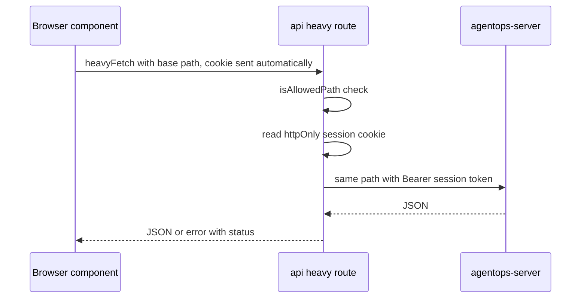

# Frontends

How the web app and marketing site are built, and how the web app reaches the backend without exposing tokens. It also lists the UI rules recorded while building them. Read this before changing anything under `apps/`.

`apps/web/CLAUDE.md` adds one rule for agents: this Next.js version differs from older ones, so read the bundled guide in `node_modules/next/dist/docs/` before writing code. This doc does not repeat that guide.

## Apps

| App | Stack | Serves | Talks to |
| --- | --- | --- | --- |
| `apps/web` | Next.js 16 (App Router), React 19, Tailwind 4, shadcn/Radix, SWR | the signed-in product, under `/suite` | `agentops-server`, server-side only |
| `apps/marketing` | Astro 7 with one React island | the public site at the root path | `POST /contact-leads` only |

The bundled Caddy and Kubernetes ingress configs route the site root to the marketing app and `/suite/*` to the web app (`apps/marketing/README.md`).

## Web app structure

Routes live in `apps/web/src/app`:

| Route | Screen | Auth |
| --- | --- | --- |
| `(app)/` | Overview dashboard | session |
| `(app)/repositories`, `repositories/connect`, `repositories/[connectionId]` | Repository list, connect wizard, repo detail | session |
| `(app)/search` | Search | session |
| `(app)/graph` | Knowledge Graph | session |
| `(app)/gotchas` | Gotchas and curation | session |
| `(app)/docs` | Documentation Viewer | session |
| `(app)/libraries` | Libraries | session |
| `(app)/profile`, `(app)/settings` | Profile, team and org settings | session |
| `login`, `welcome` | Sign-in, first-run onboarding | public / session |
| `invite` | Invite preview and accept | public |
| `cli-auth` | Device-flow approval ([09-auth-teams-security.md](09-auth-teams-security.md)) | session |
| `setup` | First-run infrastructure wizard for the PM2 install; shows the generated instance API key once | public, before any account exists |
| `api/auth/*`, `api/bootstrap/config`, `api/invites/[token]`, `api/heavy/[...path]` | Route handlers | see below |

`(app)/layout.tsx` calls `requireUser()` once per request, which validates the session against the backend. Components are grouped by screen under `apps/web/src/components/`, with shared pieces in `shared/`, `shell/` and the shadcn primitives in `ui/`.

## Base path

The web app is served under a base path, default `/suite`, so the site root is free for the marketing app. One env var sets it everywhere: `AGENTOPS_WEB_APP_BASE_PATH`, read by `apps/web/next.config.ts` and by the backend's `web_app_base_path()` for links it builds.

`next.config.ts` inlines the value into both bundles through its `env` field. Next.js prefixes `next/link`, the router and `redirect()` automatically. Raw URLs are not prefixed:

- A raw `fetch("/api/...")` resolves against the origin root and misses the app. Wrap it with `withBasePath` (`apps/web/src/lib/base-path.ts`; gotcha 53913).
- In `proxy.ts`, `request.nextUrl` has the base path stripped, and `NextResponse.redirect(new URL(...))` does not add it back. Redirect targets are built with `BASE_PATH` by hand (comment in `apps/web/src/proxy.ts`).

The build uses `output: "standalone"`, which both the Docker image and the PM2 install run as `node .next/standalone/server.js`.

## Calling the backend

The session token must never reach browser JavaScript. Every authenticated call therefore goes through a Next.js route handler that adds the token on the server.

| Piece | File | Role |
| --- | --- | --- |
| `heavyFetch` | `apps/web/src/lib/api/heavy-fetch.ts` | Browser-side client. Calls the same-origin `/api/heavy/*` with `withBasePath`, `cache: "no-store"`. |
| `proxyHeavyApi`, `isAllowedPath` | `apps/web/src/lib/server/heavy-proxy.ts` | The only generic forwarding route. Forwards only `ALLOWED_PREFIXES`; anything else is a 404 before any backend call. |
| `heavyApiFetch`, `HEAVY_API_URL` | `apps/web/src/lib/server/heavy-api.ts` | Server-only client. Base URL `AGENTOPS_HEAVY_API_URL`, default `http://127.0.0.1:8420`, deliberately not `NEXT_PUBLIC_`. |
| Session helpers | `apps/web/src/lib/auth/session.ts` | The only place the cookie is read. Sets it `httpOnly`, `sameSite: lax`, `secure` by request scheme (gotcha 54081). |
| `httpFetchJson` | `apps/web/src/lib/http-fetch.ts` | Shared fetch, JSON and error core for both clients. |
| `proxyCredentialsAuth`, `proxyLogin2fa`, `clientIpHeaders` | `apps/web/src/lib/server/auth-proxy.ts` | Login, signup and 2FA proxies. They forward the browser's address as `X-Real-IP` (the proxy-set `x-real-ip`, else the last `x-forwarded-for` hop), which the backend's rate limits need. |

`ALLOWED_PREFIXES` lists `auth/me`, `auth/sessions`, `auth/2fa`, `auth/api-keys`, `auth/cli/device/approve`, `team`, `invites`, `repos`, `integrations`, `gotchas`, `local-search`, `activity` and `libraries`. A new backend route the browser needs must be added there. Only the approve step of the device flow is listed; the CLI calls the other device routes directly.

Per-screen API modules (`repos-api.ts`, `team-api.ts`, `profile-api.ts`, `libraries-api.ts`, `integrations-api.ts` in `apps/web/src/lib/api/`) wrap `heavyFetch`. `apiFetch` in `apps/web/src/lib/api/fetcher.ts` is a leftover client for a public, unauthenticated base URL; nothing imports it.

### Auth gate

`apps/web/src/proxy.ts` redirects any request without a session cookie to `<base>/login?from=...`. It checks presence only; validation happens in `(app)/layout.tsx`. Next.js 16 renamed `middleware.ts` to `proxy.ts` (gotcha 54030).

The matcher is an allowlist by exclusion. Every public route must be excluded explicitly, or signed-out visitors are redirected away from it (gotchas 54056, 54031). Currently excluded: `login`, `api/auth`, `invite/`, `api/invites`, `setup`, `api/bootstrap`, `llms.txt`, `llms-full.txt` and Next.js static assets.

### Public API URL

`agentops connect --remote` needs the API's external address, which differs from the web app's own origin in every deployment shape. `AGENTOPS_PUBLIC_API_URL`, read at runtime, supplies it (`apps/web/src/lib/server/public-api-url.ts`). A build-time `NEXT_PUBLIC_*` value cannot know a self-hoster's port mapping. Without the var, the code guesses the request's hostname plus port 8420 and says so to the user.

## Data fetching

Client screens use SWR. Every `useSWR` call must destructure and render `error`. A hook that ignores `error` shows its loading state forever when the request fails (gotcha 53942). Gotcha 53945 records that many screens still had this gap after the first fixes. Check for it on any screen you touch.

## UI conventions

These rules come from recorded decisions and gotchas. Each was a real defect or a deliberate choice, not a style preference.

### Styling

- **`cn()` and tailwind-merge.** `cn()` merges class lists with tailwind-merge, which can drop a custom font-size token combined with a custom color token (gotcha 53937). Overriding a shadcn variant's class needs the same modifier prefix as the original, or the original wins silently (gotcha 54038). Verify any visual override in the browser.
- **One typeface.** JetBrains Mono is the app's only font, for body, headings and code (`apps/web/src/app/layout.tsx`). Decision "The search detail panel's body font is deliberately JetBrains Mono -- not an oversight if it looks monospace".
- **Node-kind colors** come from one shared map, `apps/web/src/lib/node-kind-colors.ts`, using the `--node-*` CSS tokens. Decision "Node-kind tag colors (Symbol/File/Gotcha/Decision/Note) live in one shared map -- don't reintroduce a local copy". Shapes are in `node-kind-shapes.ts`.
- **Layout.** The app shell uses `h-svh`, not `min-h-svh`; the latter broke independent pane scrolling and `position: sticky` (gotcha 53960). `SidebarInset` needs `min-w-0` (gotcha 54085).
- **Markdown content.** Gotcha, decision and note bodies are hand-written Markdown. Render them with `react-markdown`, never as plain text or a code block (gotcha 54107).

### Knowledge Graph

- The node detail panel is a `Sheet` drawer overlay. An inline side panel made the whole page scroll on long nodes (decision "Knowledge Graph's node detail panel is a Sheet drawer overlay, not an inline side-by-side flex panel -- fixes a whole-page-scroll bug").
- Nodes are not draggable (`nodesDraggable={false}` in `components/graph/graph-canvas.tsx`). Positions come from a one-shot `d3-force` layout, and panning used to grab nodes by accident (decision "Knowledge Graph nodes are non-draggable").
- The seed-centered view is capped at 150 nodes (`NODE_CAP`); the whole-repo view is uncapped on purpose. An early cap on the whole-repo view picked nodes in insertion order and showed almost no edges (decision "Whole-repo graph view (/repos/{name}/graph) is deliberately uncapped").
- React Flow's `Controls` ship light-theme CSS and need a manual dark override (gotcha 54061).

### Screens

- **Auth forms.** Password feedback is inline and live as the user types; name and email feedback is a toast (decision "auth form UX decision: password feedback is inline/live, name+email feedback is a toast", in `components/auth/`).
- **Documentation Viewer.** A nav-driven book index with one page per section, not one long scrolled document. It converged there through several rounds against real generated docs (decision "Documentation Viewer frontend converged on a nav-driven book index, not a single scrolled document").
- **List and detail pages.** A detail panel's header reads from `NodeDetail`, not from the list item it was opened from (gotcha 53989).

## Testing the web app

| Tool | Config | Scope |
| --- | --- | --- |
| Vitest + jsdom | `apps/web/vitest.config.mts`, `vitest.setup.mts` | `src/**/*.test.{ts,tsx}`: API clients, helpers, hooks, some components |
| Playwright | none committed | used ad hoc for live verification |

- `@vitejs/plugin-react` is not used: a peer conflict blocks it, and Vitest's esbuild transform handles JSX for the current scope (config comment).
- `cmdk` components need `ResizeObserver` and `scrollIntoView` polyfills under jsdom (gotcha 53978).
- In Playwright, clicking a React Flow node that opens an overlay can time out; use `dispatchEvent` (gotcha 54052).
- After restarting `next dev`, a stale browser tab can show a spurious hydration mismatch; reload cold before debugging (gotcha 54029). Do not delete `.next` while `next dev` runs (gotcha 54068).

Run with `npm test` in `apps/web`. Lint is `npm run lint`. The shadcn-generated `use-mobile.ts` hook fails the project's `react-hooks/set-state-in-effect` lint rule (gotcha 54083).

## Marketing site

`apps/marketing` is a static Astro site: the home page, `pricing.astro`, and one page per feature generated from `src/data/features` (`features/[id].astro`). One React island renders the knowledge-graph hero with `d3-force`.

- **No login or registration, by design.** Calls to action link to the self-host quick start in the main README (`apps/marketing/README.md`).
- **One backend call.** The contact form posts to `POST /contact-leads`. Its base is `AGENTOPS_PUBLIC_API_URL`, read at build time and baked into the output.
- **Pricing.** `pricing.astro` presents the free, open-source, self-hosted offering.
- **Hardcoded hosts.** The canonical and Open Graph domain is set as `site` in `astro.config.mjs`, unlike every other environment-dependent value (gotcha 54021). Header and footer link to a fixed documentation host.
- **Astro env vars.** Only `PUBLIC_`-prefixed vars reach client-side `<script>` bundles (gotcha 53962). React 19 TSX in Astro needs an explicit `JSX` type import (gotcha 54060).
- `npm test` builds first, then runs route smoke tests (`src/lib/route-smoke.test.ts`).
- Deployed as the `marketing` service in `docker-compose.yml` and `deploy/k8s/marketing-*.yaml`.

## Open questions

- None specific to the frontends. Backend-facing questions are in [07-mcp-and-rest-contracts.md](07-mcp-and-rest-contracts.md) and [09-auth-teams-security.md](09-auth-teams-security.md).
